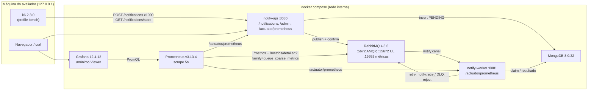

# Phase 4: Observabilidade, demo e documentação - Research

**Researched:** 2026-11-01
**Domain:** Docker Compose multi-stage (Maven multi-módulo), Prometheus + Grafana provisionados, k6, benchmark de virtual threads, documentação pt-BR com Mermaid e `explain()`
**Confidence:** HIGH (quase tudo verificado empiricamente nesta sessão contra as imagens pinadas e os jars reais)

## Summary

A fase é de integração e vitrine. Quase tudo que o dashboard precisa já existe no worker: subi o worker e a API reais (jars `*-exec.jar` atuais, profile `demo`) contra RabbitMQ 4.3.6 e Mongo 8.0.32, gerei tráfego com destinatários mágicos e capturei o `/actuator/prometheus`. Os nomes das séries do worker (`notify_delivery_*`), do Resilience4j (`resilience4j_circuitbreaker_state{name,state}`, `resilience4j_circuitbreaker_not_permitted_calls_total`, `resilience4j_bulkhead_*`), do driver Mongo (`mongodb_driver_pool_*`) e do HTTP (`http_server_requests_seconds`) estão confirmados e citados abaixo. Três descobertas mudam o plano: (1) o endpoint padrão `/metrics` do `rabbitmq_prometheus` **não tem rótulo `queue`**, então a profundidade por fila (delay e DLQ) exige um segundo job do Prometheus em `/metrics/detailed?family=queue_coarse_metrics` (verificado, inclusive com o Prometheus v3.13.4 coletando); (2) `http_server_requests_seconds` sai como **summary sem buckets**, então o p95 do `POST /notifications` exige `management.metrics.distribution.percentiles-histogram.http.server.requests=true` na API; (3) a API ainda não tem `micrometer-registry-prometheus` nem expõe `prometheus`.

Grafana 12.4.12 com acesso anônimo Viewer, datasource com `uid: prometheus` e `default_home_dashboard_path` foi provisionado e testado nesta sessão: a home anônima devolve o dashboard "Notify Hub" sem login. A imagem `eclipse-temurin:21-jre` (hoje 21.0.13) traz `curl` e o binário `jfr`, mas não `jcmd`, e roda como root. O build multi-stage precisa de **todos** os POMs de módulo no contexto (o reator falha sem `notify-it/pom.xml`, verificado).

O spike do benchmark (DEM-03) rodou nesta sessão e mostrou o que o README precisa dizer com honestidade: **com a mesma concorrência de listener, virtual threads não aumentam a vazão do worker**. Cada consumidor do `SimpleMessageListenerContainer` já tem a sua thread, virtual ou de plataforma, então a vazão é limitada pela latência e pelo I/O, não pelo tipo de thread. O que muda é o custo: 41–44 threads de plataforma vivas com VT contra 187 sem VT, com 50 consumidores por canal. O spike também revelou dois bloqueadores de configuração do benchmark: o worker **não sobe** fora do profile `demo` com níveis `1s,5s,25s` se `NOTIFY_CB_OPEN_WAIT` não for reduzido, e a varredura da API vira o backlog para `PUBLISH_FAILED` depois de 2 minutos (o worker ainda entrega, mas polui o `/stats`).

**Primary recommendation:** Faça um `Dockerfile` por app com contexto na raiz e cache BuildKit do `~/.m2`. Configure dois jobs de scrape para o RabbitMQ, um JSON de dashboard clássico com datasource de uid fixo, e um k6 que imprime o resumo no `teardown` sem importar jslib remota. Para o benchmark, meça a vazão de drenagem do worker pelo Mongo (`claimedAt`/`sentAt`) num override de compose próprio, e escreva no README o resultado real, inclusive se der empate.

<user_constraints>
## User Constraints (from CONTEXT.md)

### Locked Decisions

#### Dashboard Grafana (OBS-03)
- **D-01:** O Grafana provisiona **um único dashboard "Notify Hub"**, organizado em linhas (rows):
  1. Visão geral: throughput, totais e taxa de sucesso;
  2. Entrega por canal: `notify_delivery_outcomes` por canal e outcome, p95 de `notify_delivery_duration`;
  3. Retry e DLQ: `notify_delivery_retries` por nível e profundidade das filas de delay e das DLQs vinda do `rabbitmq_prometheus`;
  4. Resiliência: CB e bulkhead;
  5. API e JVM: HTTP, publish, threads e heap.

  A demo e o benchmark usam o mesmo dashboard. A home do Grafana aponta para ele. — **Reversibility:** reversible.
- **D-02:** O dashboard mostra métricas da API. A API passa a expor `prometheus` no actuator (`micrometer-registry-prometheus`), o que o OBS-02 já exige, e o dashboard traz taxa e p95 de `POST /notifications` (`http_server_requests`). A API ganha **um contador novo de resultado do publish** (confirmado vs PUBLISH_FAILED, por motivo num conjunto fechado: nack/timeout/returned/unconfirmed-sweep, ou o que o código já distingue), pré-registrado e com tags de baixa cardinalidade, como no D-15 da Fase 2. Assim o 503 fica visível no gráfico. — **Reversibility:** costly — o nome e as tags da métrica nova passam a ser usados pelo dashboard e pelo README, como no D-15.
- **D-03:** O estado do circuit breaker aparece como **linha do tempo por canal** (state timeline: fechado verde, aberto vermelho, half-open amarelo), a partir de `resilience4j_circuitbreaker_state`.
- **D-04:** No profile `demo` o CB fica aberto por **500ms**, e esse valor **continua como está** (decisão da Fase 2). Como um scrape de 5s pode não pegar o gauge em OPEN, a linha de Resiliência traz **ao lado da linha do tempo um painel de taxa de recusas**: `notify_delivery_rejections{reason=circuit_open|bulkhead_full}` e/ou as chamadas `not_permitted` do Resilience4j. Contadores não perdem eventos entre scrapes, então a abertura sempre aparece. Não mudar o `wait-duration-in-open-state` do profile demo.
- **D-05:** O Prometheus coleta **a cada 5s**. O dashboard abre com a janela **"últimos 15 minutos"** e refresh automático de **5s**, granular o bastante para ver a escada 1s/5s/25s durante uma rodada de k6.
- **D-06:** O Grafana usa **acesso anônimo com papel Viewer** (abre direto no dashboard, sem tela de login) e mantém `admin/admin` para edição. Como o resto do compose, a porta só escuta em `127.0.0.1`. Use a imagem `grafana/grafana:12.4.12` com JSON clássico e `provisioning/dashboards/*.yaml`, conforme o CLAUDE.md. Não use o Grafana 13.

#### Estrutura do README e docs (DOC-01..04)
- **D-07:** **README vitrine + pasta `docs/`.**
  - O README tem cerca de uma tela e meia até a demo e traz: pitch, o que o projeto demonstra, diagrama Mermaid de arquitetura, "como rodar" em poucos comandos (`docker compose up --build` + k6), links para Grafana, RabbitMQ e Swagger, destaques, resumo do benchmark com números e links para os docs.
  - A pasta `docs/` traz, com nomes sugeridos que o planner pode ajustar:
    - `arquitetura.md`: componentes, topologia RabbitMQ em Mermaid e ciclo de vida do status em Mermaid (`stateDiagram`);
    - `modelagem-mongo.md`: modelo de documentos, índices, ESR e `explain()`;
    - `benchmark.md`: método completo, resultados e como reproduzir;
    - `trade-offs.md`;
    - `demo.md`: roteiro passo a passo com destinatários mágicos, reprocess e o que olhar no Grafana e no painel do RabbitMQ.

  — **Reversibility:** reversible.
- **D-08:** O `explain()` vem de **script versionado + saída colada**. Um script `mongosh` em `scripts/` roda contra o Mongo do compose, depois do k6, as consultas reais que os índices atendem:
  - listagem por status+canal ordenada por `createdAt` desc;
  - listagem só por canal e sem filtro;
  - lote do `republish-failed` (status + createdAt asc);
  - varredura de PENDING não confirmado;
  - busca por `idempotencyKey`.

  O `docs/modelagem-mongo.md` cola o trecho relevante (estágio IXSCAN, índice escolhido, `keysExamined` vs `nReturned`, ausência de SORT em memória) e justifica cada índice pela regra ESR (Equality, Sort, Range). Os índices de referência estão em `MongoIndexInitializer`.
- **D-09:** **Público:** o topo do README usa linguagem direta para recrutador (o que é, o que demonstra, como rodar). Os `docs/` são técnicos e densos, escritos para o revisor técnico, com o porquê de cada decisão e os riscos aceitos.
- **D-10:** **Screenshots** ficam em `docs/img/`: um print do dashboard durante o k6, com CB/retries/DLQ visíveis, e um das filas de delay/DLQ no painel do RabbitMQ. Eles são tirados na execução real, como **checkpoint humano** no fim da fase. O plano deixa os links para as imagens prontos e pede a captura ao usuário.
- **D-11:** O **`docs/` é independente do `.planning/`.** É escrito do zero para o leitor externo, sem citar fases, D-xx, WR-xx, CR-xx ou gap closures. O `.planning/` continua versionado como histórico do processo, com no máximo uma linha no README dizendo que ele existe.
- **D-12:** **Trade-offs** em tabela-resumo com as colunas limitação, impacto e o que faria em produção, seguida de **um parágrafo curto por item**. Itens obrigatórios:
  - sem outbox (escrita dupla Mongo → broker, mitigada pela varredura PUBLISH_UNCONFIRMED + republish);
  - at-least-once com possível duplicata após crash;
  - Spring Boot 3.5 fora do suporte OSS;
  - sem jitter;
  - os riscos aceitos do `03-SECURITY.md`: sondagem de `Idempotency-Key`, `recipient` na listagem, stats sem cache, API pública sem rate limit, `demo-admin-key` versionada;
  - as limitações conhecidas WR-05 (cópia extra na fila no replay de PENDING ainda não reivindicado, que o claim do worker descarta) e WR-07 (log de replay dizendo "PENDING" com o documento ainda PUBLISH_FAILED), em linguagem de leitor externo, sem os códigos internos.

  Fecha com "próximos passos" ligados ao v2: outbox, Boot 4, jitter, correlation ID.

### Claude's Discretion
O usuário não escolheu discutir estas áreas. Os padrões abaixo são recomendações que o pesquisador e o planner podem refinar com evidência:

- **Desenho do benchmark (DEM-03):** fazer o spike curto que o roadmap pede antes do código.
  - Alvo recomendado: **tempo de drenagem do worker** como métrica principal. Publicar N mensagens com o worker parado ou listeners desligados, ligar e medir até todas ficarem SENT via Prometheus ou `/stats`. É onde o bloqueio simulado mais pesa. A latência da API sob `constant-arrival-rate` entra como medida secundária, se couber no prazo.
  - Só `VIRTUAL_THREADS` varia. Ficam iguais: concorrência alta (por exemplo 200 consumidores por canal), prefetch, latência do adapter e `maxPoolSize` do Mongo, com failure-rate 0, destinatários mágicos desligados, bulkhead ≥ concorrência e CB neutralizado.
  - Usar um profile ou override de ENV próprio, **sem o profile `demo`**, porque no demo o `wait-duration-in-open-state` é literal e não aceita ENV (blocker da Fase 2).
  - Aquecimento descartado e **várias execuções**, com mediana e dispersão. A varredura de concorrência é opcional e serve para mostrar onde as threads de plataforma saturam.
  - Captura JFR de `jdk.VirtualThreadPinned` como evidência.
  - O método e os números vão para `docs/benchmark.md`, com o resumo no README. Os números são da máquina do autor e o hardware é declarado.
- **Script k6 (DEM-02):** `grafana/k6:2.3.0` no compose sob `profiles: ["bench"]`, executor `shared-iterations` (50 VUs, 1000 iterações), mix dos três canais e dos três templates do seed com uma fração de destinatários mágicos (always-transient, always-permanent, fail-N-then-ok, fail-until-reprocess) suficiente para abrir o CB e povoar retries e DLQ. Thresholds como `http_req_failed` < 1%. No `handleSummary`/teardown, o script espera os estados terminais com limite de tempo, lê `GET /notifications/stats` (formato D-12 da Fase 3) e imprime o resumo. Chamar o reprocess da DLQ ao final é opcional e pode ficar no roteiro do `docs/demo.md`.
- **Compose:** as apps sobem com o **profile `demo`** por padrão (TTLs curtos, destinatários mágicos ligados, `demo-admin-key`). Os healthchecks e o `depends_on: service_healthy` seguem o padrão do compose atual, e as portas só escutam em `127.0.0.1`. Os Dockerfiles copiam `*-exec.jar`. Habilitar `rabbitmq_prometheus` e conferir se a imagem 4.3 já o liga por padrão. As tags de imagem são as do CLAUDE.md.
- O layout exato dos painéis, as queries PromQL, as cores e a organização dos arquivos de provisionamento.

### Deferred Ideas (OUT OF SCOPE)
Nenhuma. A discussão ficou dentro do escopo da fase.
</user_constraints>

<phase_requirements>
## Phase Requirements

| ID | Description | Research Support |
|----|-------------|------------------|
| OBS-02 | Prometheus coleta métricas da API, do worker e do RabbitMQ (`rabbitmq_prometheus`) | §Padrão 3 (scrape com 4 jobs, `params.family` verificado), §Padrão 2 (API ganha registry + exposição), Armadilhas 1 e 2 |
| OBS-03 | Grafana sobe com datasource e dashboard provisionados (throughput, resultados, retries por nível, DLQs, p95, CB) | §Padrão 4 (provisionamento testado no 12.4.12), §Catálogo de séries e PromQL, Armadilhas 3, 4 e 5 |
| DEM-01 | Dockerfiles multi-stage e um único `docker compose up --build` | §Padrão 1 (Dockerfile + compose), Armadilhas 6, 7 e 8 |
| DEM-02 | k6 com 1000 notificações, mix de canais e destinatários mágicos, resumo final | §Padrão 5 (script), cálculo do mix que abre o CB, Armadilhas 9, 10 e 11 |
| DEM-03 | Benchmark VT vs plataforma, só o tipo de thread varia, aquecimento e várias execuções | §Padrão 6 (desenho + spike real), Armadilhas 12 a 16 |
| DOC-01 | README pt-BR com Mermaid (arquitetura, topologia, ciclo de vida) e passo a passo | §Padrão 7, valores verbatim de filas, status e transições |
| DOC-02 | Índices compostos com ESR e `explain()` | §Padrão 8 (planos reais capturados nesta sessão) |
| DOC-03 | Trade-offs (outbox, at-least-once, Boot 3.5, jitter + riscos aceitos) | §Padrão 7 (lista de itens com origem), §Segurança |
| DOC-04 | Toda a documentação em pt-BR | Convenção do projeto; §Armadilha 17 (identificadores em inglês ficam) |
</phase_requirements>

## Project Constraints (from CLAUDE.md)

- Stack fixa: Java 21, Spring Boot 3.5.16, Spring AMQP, Spring Data MongoDB (síncrono), Resilience4j 2.4.0, Micrometer, Testcontainers 1.21.4, Docker Compose. Não sobrescrever versões gerenciadas pelo BOM (`spring-amqp.version`, `mongodb.version`, `micrometer.version`...).
- Maven multi-módulo com wrapper 3.9.16. Não usar Maven 4 RC.
- Imagens pinadas, nunca `:latest`: `rabbitmq:4.3.6-management`, `mongo:8.0.32`, `prom/prometheus:v3.13.4` (LTS), `grafana/grafana:12.4.12` (**não** usar Grafana 13), `eclipse-temurin:21-jre`, `maven:3.9-eclipse-temurin-21`, `grafana/k6:2.3.0`.
- Compose v2 sem a chave `version:` no topo. Usar `healthcheck` + `depends_on: condition: service_healthy`. O k6 fica em `profiles: ["bench"]`.
- Multi-stage Dockerfile (não usar `spring-boot:build-image`, que exigiria Maven antes do `compose up`).
- Não usar `ThreadPoolBulkhead`, retry em memória do Spring AMQP, requeue em falha, `x-queue-mode`/`x-queue-version`, filas não duráveis nem `global-qos`.
- Benchmark: alternar só `VIRTUAL_THREADS=true|false`. Manter iguais `WORKER_CONCURRENCY`, prefetch, latência e failure rate (0% no benchmark) e `maxPoolSize` do Mongo.
- k6: `shared-iterations` para a demo; `constant-arrival-rate` (modelo aberto) se houver comparação de API. Não seguir posts da era 1.x com `externally-controlled`.
- JFR (`jdk.VirtualThreadPinned`) ou `-Djdk.tracePinnedThreads=full` como evidência de pinning.
- Documentação toda em pt-BR; código e identificadores podem ficar em inglês.
- Reprodutibilidade: a demo sobe com `docker compose up` e um script, sem passos manuais.
- Fluxo GSD: edições só dentro de comandos GSD (`/gsd-execute-phase` para esta fase).

## Architectural Responsibility Map

| Capability | Primary Tier | Secondary Tier | Rationale |
|------------|-------------|----------------|-----------|
| Expor métricas da API (`/actuator/prometheus`, contador de publish) | API / Backend (`notify-api`) | — | Só a API sabe o resultado do publish e a latência HTTP |
| Métricas de entrega, retry, CB, bulkhead | API / Backend (`notify-worker`) | — | Já implementado (D-15 da Fase 2); só consumido aqui |
| Profundidade de filas (delay, DLQ, principal) | Broker (RabbitMQ `rabbitmq_prometheus`) | — | O broker é a fonte de verdade das filas; nenhum código de app |
| Coleta e armazenamento de séries | Observabilidade (Prometheus) | — | Scrape a cada 5s dos 4 alvos |
| Visualização, home e acesso anônimo | Observabilidade (Grafana) | — | Provisionamento por arquivo, sem passo manual |
| Build e empacotamento | Build (Dockerfile multi-stage) | Compose | O Maven roda dentro do container; o reviewer não precisa de JDK |
| Geração de carga e resumo | Ferramenta externa (k6 em container) | API (lê `/stats`) | O k6 é cliente HTTP; o resumo vem do contrato `/notifications/stats` |
| Medição do benchmark | Database (Mongo: `claimedAt`/`sentAt`) | Prometheus (threads, pool) | Timestamps por documento não dependem do intervalo de scrape |
| Evidência de índices | Database (`explain()` via `mongosh` no container) | Docs | Plano real do servidor, não do driver |
| Documentação | Docs (`README.md`, `docs/`) | — | Independente do `.planning/` (D-11) |

## Standard Stack

### Core (sem bibliotecas novas; uma dependência gerenciada a mais na API)

| Componente | Versão | Propósito | Por que |
|------------|--------|-----------|---------|
| `io.micrometer:micrometer-registry-prometheus` | gerenciada pelo Boot 3.5.16 (Micrometer 1.15.12) | `/actuator/prometheus` na API | Já usada no worker [VERIFIED: notify-worker/pom.xml:113-117 "<artifactId>micrometer-registry-prometheus</artifactId>"]; a API não tem [VERIFIED: notify-api/pom.xml:18-57, sem a dependência] |
| `prom/prometheus` | `v3.13.4` | Coleta | Tag existe [VERIFIED: docker manifest inspect + pull nesta sessão]; `promtool check config` aceitou a config de exemplo [VERIFIED: saída "SUCCESS: /p.yml is valid prometheus config file syntax"] |
| `grafana/grafana` | `12.4.12` | Dashboard | Tag existe e provisionamento testado [VERIFIED: `/api/health` respondeu `"version": "12.4.12"`] |
| `grafana/k6` | `2.3.0` | Carga | [VERIFIED: `k6 v2.3.0 (commit/e088784614, go1.27.1, linux/amd64)`]; entrypoint é `k6`; roda como uid 12345 |
| `eclipse-temurin` | `21-jre` (hoje resolve para 21.0.13, Ubuntu 26.04.1) | Runtime | [VERIFIED: `openjdk version "21.0.13" 2026-10-20 LTS`]; traz `/usr/bin/curl` e `bin/jfr`; sem `jcmd`; uid 0 |
| `maven` | `3.9-eclipse-temurin-21` | Estágio de build | Tag existe [VERIFIED: docker manifest inspect] |
| `rabbitmq` | `4.3.6-management` | Broker | `rabbitmq_prometheus` já habilitado [VERIFIED: `rabbitmq-plugins list -e` → `[E*] rabbitmq_prometheus 4.3.6`] |
| `mongo` | `8.0.32` | Banco + `mongosh` para o `explain()` | Já no compose |

### Supporting

| Item | Propósito | Quando usar |
|------|-----------|-------------|
| BuildKit cache mount (`RUN --mount=type=cache,target=/root/.m2`) | Evita baixar todas as dependências a cada `--build` | Nos dois Dockerfiles [CITED: docs.docker.com/build/cache/optimize/#use-cache-mounts] |
| `jfr` do JRE (ou do JDK do host) | Ler o `.jfr` do benchmark | `jfr summary` / `jfr print --events jdk.VirtualThreadPinned` |
| `docker stats --no-stream` | RSS do container no benchmark (pilhas de threads de plataforma são memória nativa, fora do heap) | Medida secundária do benchmark |

### Alternatives Considered

| Em vez de | Poderia usar | Tradeoff |
|-----------|--------------|----------|
| Job `/metrics/detailed?family=queue_coarse_metrics` | `/metrics/per-object` | Também traz `queue` [VERIFIED: `rabbitmq_queue_messages_ready{vhost="/",queue="notify.email"}`], mas exporta todas as famílias por objeto (mais pesado). Com ~15 filas tanto faz; o `detailed` é mais enxuto |
| Job `/metrics/detailed` | `prometheus.return_per_object_metrics = true` no `rabbitmq.conf` | Exige montar arquivo de config no broker e muda o endpoint padrão; o docs do RabbitMQ desaconselham para muitos objetos |
| `teardown()` imprimindo o resumo | `handleSummary()` + `textSummary` | `textSummary` só existe como import remoto de `jslib.k6.io` [CITED: grafana.com/docs/k6/latest/results-output/end-of-test/custom-summary/ — `import { textSummary } from 'https://jslib.k6.io/k6-summary/0.0.2/index.js';`]; exportar `handleSummary` sem ele suprime o resumo padrão. Dependência de rede em tempo de execução quebra a reprodutibilidade |
| Dockerfile por módulo | Um Dockerfile com `ARG MODULE` | Um só arquivo é menos repetição, mas o DEM-01 fala em "Dockerfiles" e um por app é mais legível para o revisor |
| Medir pelo Mongo (`claimedAt`/`sentAt`) | Medir por `rate()` no Prometheus | Scrape de 5s dá resolução ruim para drenagens de 10–30s; os timestamps por documento são exatos |

**Installation (API):**
```xml
<!-- notify-api/pom.xml, versão gerenciada pelo Boot -->
<dependency>
    <groupId>io.micrometer</groupId>
    <artifactId>micrometer-registry-prometheus</artifactId>
</dependency>
```

## Package Legitimacy Audit

| Package | Registry | Age | Downloads | Source Repo | Verdict | Disposition |
|---------|----------|-----|-----------|-------------|---------|-------------|
| `io.micrometer:micrometer-registry-prometheus` | Maven Central (gerenciado pelo BOM do Boot 3.5.16) | anos | muito alto | github.com/micrometer-metrics/micrometer | OK (já usado no worker desde a Fase 2) | Approved |

O seam `package-legitimacy` cobre npm/PyPI/crates, não Maven. Esta fase não adiciona nenhum artefato novo ao projeto: a única dependência é a mesma que o `notify-worker` já usa, com versão do BOM. O script k6 **não** deve importar módulos remotos (`jslib.k6.io`); assim não entra nenhum pacote de terceiros em tempo de execução.

**Packages removed due to [SLOP] verdict:** none
**Packages flagged as suspicious [SUS]:** none

## Architecture Patterns

### System Architecture Diagram



### Recommended Project Structure

```
.
├── docker-compose.yml               # estende o atual: api, worker, prometheus, grafana, k6 (profile bench)
├── docker-compose.bench.yml         # override do benchmark (só ENV), usado com -p notify-bench
├── .dockerignore                    # target/, .git/, .planning/, .gsd/, docs/, *.log, .idea/
├── notify-api/Dockerfile            # multi-stage, contexto = raiz
├── notify-worker/Dockerfile         # multi-stage, contexto = raiz
├── observability/
│   ├── prometheus/prometheus.yml
│   └── grafana/
│       ├── provisioning/datasources/prometheus.yaml
│       ├── provisioning/dashboards/notify-hub.yaml
│       └── dashboards/notify-hub.json
├── k6/
│   └── demo.js                      # 1000 notificações + resumo
├── scripts/
│   ├── explain-indices.js           # mongosh: planos das consultas reais (D-08)
│   └── bench/                       # run-bench.sh (Git Bash) + drain-stats.js (mongosh)
├── docs/
│   ├── arquitetura.md, modelagem-mongo.md, benchmark.md, trade-offs.md, demo.md
│   └── img/                         # screenshots (checkpoint humano, D-10)
└── README.md
```

### Padrão 1: Dockerfile multi-stage para Maven multi-módulo (DEM-01)

**O quê:** build dentro do container com o `mvn` da imagem, reator restrito ao módulo com `-pl <app> -am`, cache BuildKit do repositório local, cópia do `*-exec.jar`.

**Fatos verificados que moldam o arquivo:**
- O POM pai lista quatro módulos, inclusive o `notify-it` [VERIFIED: pom.xml:26-32 `<module>notify-common</module>` `<module>notify-api</module>` `<module>notify-worker</module>` `<module>notify-it</module>`]. Sem `notify-it/pom.xml` no contexto, o Maven aborta mesmo com `-pl notify-api -am` [VERIFIED nesta sessão: `[ERROR] Child module ...\reactor\notify-it of ...\reactor\pom.xml does not exist`]. Copie **os quatro POMs**.
- O jar executável tem classifier `exec` [VERIFIED: notify-api/pom.xml:68-73 `<id>repackage</id>` ... `<classifier>exec</classifier>`; notify-worker/pom.xml:67-75 idem]. O nome é `notify-<app>-0.1.0-SNAPSHOT-exec.jar` [VERIFIED: `ls notify-api/target` → `notify-api-0.1.0-SNAPSHOT-exec.jar`].
- A imagem de runtime tem `curl` (healthcheck) e roda como root (crie um usuário) [VERIFIED: `/usr/bin/curl`, `id -u` → `0`].

```dockerfile
# notify-api/Dockerfile (o do worker é igual trocando o módulo e a porta)
# syntax=docker/dockerfile:1
FROM maven:3.9-eclipse-temurin-21 AS build
WORKDIR /src
# Os quatro POMs: o reator lê todos os módulos do pai, mesmo com -pl (notify-it incluído)
COPY pom.xml .
COPY notify-common/pom.xml notify-common/
COPY notify-api/pom.xml notify-api/
COPY notify-worker/pom.xml notify-worker/
COPY notify-it/pom.xml notify-it/
COPY notify-common/src notify-common/src
COPY notify-api/src notify-api/src
RUN --mount=type=cache,id=notify-m2,target=/root/.m2,sharing=locked \
    mvn -B -q -pl notify-api -am -DskipTests package

FROM eclipse-temurin:21-jre
RUN groupadd --system app && useradd --system --gid app --no-create-home app
WORKDIR /app
COPY --from=build /src/notify-api/target/notify-api-*-exec.jar /app/app.jar
USER app
EXPOSE 8080
# Forma exec: o java é o PID 1 e recebe o SIGTERM do "docker compose stop" (JFR faz dump na saída)
ENTRYPOINT ["java", "-XX:MaxRAMPercentage=75", "-jar", "/app/app.jar"]
```
`[ASSUMED]` `groupadd`/`useradd` existem no Ubuntu 26.04 da imagem (padrão do Ubuntu; confirme no primeiro build). `sharing=locked` serializa os dois builds paralelos no mesmo cache para não corromper o repositório local `[ASSUMED]`.

**Compose (trecho a adicionar ao `docker-compose.yml` atual):**
```yaml
  api:
    build: { context: ., dockerfile: notify-api/Dockerfile }
    environment:
      SPRING_PROFILES_ACTIVE: demo
      MONGODB_URI: mongodb://mongo:27017/notify
      RABBITMQ_HOST: rabbitmq
    ports: ["127.0.0.1:8080:8080"]
    depends_on:
      rabbitmq: { condition: service_healthy }
      mongo: { condition: service_healthy }
    healthcheck:
      test: ["CMD", "curl", "-fsS", "http://localhost:8080/actuator/health"]
      interval: 5s
      timeout: 3s
      retries: 20
      start_period: 30s

  worker:
    build: { context: ., dockerfile: notify-worker/Dockerfile }
    environment:
      SPRING_PROFILES_ACTIVE: demo
      MONGODB_URI: mongodb://mongo:27017/notify
      RABBITMQ_HOST: rabbitmq
      # readiness só fica UP depois dos ApplicationRunners (índices, seed, start dos listeners)
      MANAGEMENT_ENDPOINT_HEALTH_PROBES_ENABLED: "true"
    ports: ["127.0.0.1:8081:8081"]
    depends_on:
      rabbitmq: { condition: service_healthy }
      mongo: { condition: service_healthy }
    healthcheck:
      test: ["CMD", "curl", "-fsS", "http://localhost:8081/actuator/health/readiness"]
      interval: 5s
      timeout: 3s
      retries: 20
      start_period: 30s

  prometheus:
    image: prom/prometheus:v3.13.4
    volumes: ["./observability/prometheus/prometheus.yml:/etc/prometheus/prometheus.yml:ro"]
    ports: ["127.0.0.1:9090:9090"]

  grafana:
    image: grafana/grafana:12.4.12
    environment:
      GF_AUTH_ANONYMOUS_ENABLED: "true"
      GF_AUTH_ANONYMOUS_ORG_ROLE: Viewer
      GF_DASHBOARDS_DEFAULT_HOME_DASHBOARD_PATH: /var/lib/grafana/dashboards/notify-hub.json
      GF_SECURITY_ADMIN_USER: admin
      GF_SECURITY_ADMIN_PASSWORD: admin
    volumes:
      - ./observability/grafana/provisioning:/etc/grafana/provisioning:ro
      - ./observability/grafana/dashboards:/var/lib/grafana/dashboards:ro
    ports: ["127.0.0.1:3000:3000"]
    depends_on: [prometheus]

  k6:
    image: grafana/k6:2.3.0
    profiles: ["bench"]
    environment: { API_URL: "http://api:8080" }
    volumes: ["./k6:/scripts:ro"]
    command: ["run", "/scripts/demo.js"]   # dentro do YAML: o Git Bash não converte o caminho
    depends_on:
      api: { condition: service_healthy }
      worker: { condition: service_healthy }
```
Os nomes de ENV das apps existem [VERIFIED: notify-api/src/main/resources/application.yml:17 `uri: ${MONGODB_URI:mongodb://localhost:27017/notify}`, :19 `host: ${RABBITMQ_HOST:localhost}`; idem no worker :16 e :18]. As variáveis `GF_*` seguem a regra `GF_<SECTION>_<KEY>` [CITED: grafana.com/docs/grafana/latest/setup-grafana/configure-grafana/ — "periods (`.`) and dashes (`-`) must replaced by underscores"] e foram testadas no 12.4.12 nesta sessão (a home anônima devolveu o dashboard provisionado). `MANAGEMENT_ENDPOINT_HEALTH_PROBES_ENABLED` e o comportamento da readiness depois dos runners vêm da doc do Boot `[ASSUMED]`. Se a readiness não estiver disponível, `/actuator/health` também serve, só com a ressalva de que pode ficar UP segundos antes do `Listeners iniciados`.

### Padrão 2: Métricas da API (OBS-02, D-02)

1. `pom.xml` da API: `micrometer-registry-prometheus` (sem versão).
2. `application.yml` da API, hoje com [VERIFIED: notify-api/src/main/resources/application.yml:41-45 `management:` / `endpoints:` / `web:` / `exposure:` / `include: health,info`]:
```yaml
management:
  endpoints:
    web:
      exposure:
        include: health,info,prometheus
  metrics:
    distribution:
      percentiles-histogram:
        # sem isto o http_server_requests sai como summary, sem buckets, e não há p95 agregável
        http.server.requests: true
```
A ausência de buckets foi verificada no worker, que tem o mesmo starter web [VERIFIED: `# TYPE http_server_requests_seconds summary`]. As tags reais são [VERIFIED: `http_server_requests_seconds_count{error="none",exception="none",method="GET",outcome="SUCCESS",status="200",uri="/actuator/health"} 2`]. A propriedade por medidor vem da tabela de customizações por meter `[CITED: docs.spring.io/spring-boot/3.5/reference/actuator/metrics.html — "management.metrics.distribution.percentiles-histogram — Whether to publish a histogram..."]`; a forma `.http.server.requests` segue a regra de prefixo da mesma página.

3. **Contador de resultado do publish** (novo; nome e tags passam a ser contrato):
   - Valores que o código já distingue [VERIFIED: notify-api/.../messaging/PublishResult.java:12-18 `ACK,` `NACK,` `RETURNED,` `TIMEOUT,` `BROKER_UNAVAILABLE`; :47-55 `case NACK -> "PUBLISH_NACK";` `case RETURNED -> "PUBLISH_RETURNED";` `case TIMEOUT -> "PUBLISH_TIMEOUT";` `case BROKER_UNAVAILABLE -> "BROKER_UNAVAILABLE";`] e o código da varredura [VERIFIED: NotificationRepublisher.java:69 `public static final String PUBLISH_UNCONFIRMED = "PUBLISH_UNCONFIRMED";`].
   - Ponto único de contagem: `NotificationRepublisher.publishOrMarkFailed` (usado pela criação e pelo replay [VERIFIED: NotificationService.java:120 e :202 `republisher.publishOrMarkFailed(...)`] e pelo `republish`/lote) e `markUnconfirmedAsPublishFailed` (varredura, `increment(marked)`). **Não** contar em `NotificationPublisher.publish`: ele também serve ao reprocesso da DLQ e ao `copyToDlqTail`, cujas falhas não gravam PUBLISH_FAILED [VERIFIED: grep → DlqReprocessService.java:197 `publisher.publish(` e :210 `publisher.copyToDlqTail(`].
   - Recomendação: `notify.publish.outcomes` (Prometheus: `notify_publish_outcomes_total`) com tags `outcome` e `reason`, pré-registrado com o mesmo conjunto de chaves em todas as séries (regra do D-15: o registry Prometheus descarta meters de mesmo nome com chaves diferentes [VERIFIED: DeliveryMetrics.java:27-29 "o registry Prometheus descarta meters de mesmo nome com chaves diferentes; por isso {@code sent} leva {@code failure_class="none"}"]):
     | outcome | reason | quando |
     |---------|--------|--------|
     | `confirmed` | `none` | `result.ok()` |
     | `confirmed` | `claimed` | sem confirm, mas a releitura mostra claim do worker (ramo `wasClaimedByWorker`) |
     | `publish_failed` | `nack` / `returned` / `timeout` / `broker_unavailable` | `Optional.of(result)` devolvido |
     | `publish_failed` | `unconfirmed` | varredura, por documento marcado |
     Os valores das tags (`confirmed`, `claimed`, `publish_failed`, `unconfirmed`...) são proposta `[ASSUMED]`; o planner pode ajustar antes de virar contrato. Um `@Component PublishMetrics` espelhando `DeliveryMetrics` (construtor registra tudo; testes com `SimpleMeterRegistry`, como `DeliveryMetricsTest`) mantém o padrão.

### Padrão 3: Prometheus (OBS-02, D-05)

```yaml
# observability/prometheus/prometheus.yml
global:
  scrape_interval: 5s
  evaluation_interval: 5s
scrape_configs:
  - job_name: api
    metrics_path: /actuator/prometheus
    static_configs: [{ targets: ["api:8080"] }]
  - job_name: worker
    metrics_path: /actuator/prometheus
    static_configs: [{ targets: ["worker:8081"] }]
  - job_name: rabbitmq                 # agregados do nó (sem rótulo queue)
    static_configs: [{ targets: ["rabbitmq:15692"] }]
  - job_name: rabbitmq-queues          # profundidade por fila
    metrics_path: /metrics/detailed
    params:
      family: [queue_coarse_metrics]
    static_configs: [{ targets: ["rabbitmq:15692"] }]
```
Verificado nesta sessão com `prom/prometheus:v3.13.4`: os dois jobs do RabbitMQ ficaram `"health":"up"`, com `scrapeUrl` `http://rabbitmq:15692/metrics/detailed?family=queue_coarse_metrics`, e a query devolveu `rabbitmq_detailed_queue_messages{instance="rabbitmq:15692",job="rabbitmq-queues",queue="notify.email.dlq",vhost="/"} 5`. Use o rótulo `job` (api/worker) para separar as JVMs no painel. Não é preciso tag `application` no código.

### Padrão 4: Grafana provisionado (OBS-03, D-01..D-06)

Testado nesta sessão no `grafana/grafana:12.4.12`: datasource com uid fixo, provider de arquivo, `GF_DASHBOARDS_DEFAULT_HOME_DASHBOARD_PATH` e acesso anônimo. O resultado foi `GET /api/dashboards/home` anônimo → `"title":"Notify Hub"`, `"canEdit":false`, e `GET /api/search?query=Notify` → `"uid":"notify-hub"`.

```yaml
# provisioning/datasources/prometheus.yaml
apiVersion: 1
datasources:
  - name: Prometheus
    uid: prometheus          # o JSON do dashboard referencia {"type":"prometheus","uid":"prometheus"}
    type: prometheus
    access: proxy
    url: http://prometheus:9090
    isDefault: true
    editable: false
    jsonData:
      timeInterval: 5s       # base do $__rate_interval (4x o scrape)
```
```yaml
# provisioning/dashboards/notify-hub.yaml
apiVersion: 1
providers:
  - name: notify-hub
    type: file
    disableDeletion: true
    allowUiUpdates: false
    options:
      path: /var/lib/grafana/dashboards
```
O dashboard JSON precisa de `"uid": "notify-hub"`, `"refresh": "5s"`, `"time": {"from": "now-15m", "to": "now"}`, rows do D-01 e `datasource` com o uid fixo em cada painel e target. Um JSON mínimo com `schemaVersion: 39`, uma `row` e um `state-timeline` foi aceito pelo provisionamento do 12.4.12 [VERIFIED nesta sessão]. A renderização visual não foi verificada: é o checkpoint humano do D-10.

### Catálogo de séries reais e PromQL recomendada

Séries capturadas do worker real nesta sessão (`curl :8081/actuator/prometheus`):

| Série (verbatim) | Rótulos (verbatim) |
|------------------|--------------------|
| `notify_delivery_outcomes_total` | `channel`, `failure_class`, `outcome`, ex.: `{channel="webhook",failure_class="transient",outcome="retrying"} 45.0` |
| `notify_delivery_retries_total` | `{channel="webhook",level="1"} 15.0` (level 1..3) |
| `notify_delivery_rejections_total` | `{channel="webhook",reason="circuit_open"} 25.0`, `reason="bulkhead_full"` |
| `notify_delivery_duration_seconds_bucket/_count/_sum/_max` | `channel`, `outcome` ∈ `success`, `transient_failure`, `permanent_failure`, `unknown_failure` (histograma: `# TYPE notify_delivery_duration_seconds histogram`) |
| `resilience4j_circuitbreaker_state` | `{name="webhook",state="half_open"} 1.0`; estados: `closed`, `disabled`, `forced_open`, `half_open`, `metrics_only`, `open` |
| `resilience4j_circuitbreaker_not_permitted_calls_total` | `{kind="not_permitted",name="webhook"} 25.0` |
| `resilience4j_circuitbreaker_calls_seconds_count` | `kind` ∈ `failed`, `ignored`, `successful` |
| `resilience4j_bulkhead_available_concurrent_calls` / `_max_allowed_concurrent_calls` | `{name="email"} 8.0` |
| `mongodb_driver_pool_checkedout`, `mongodb_driver_pool_size`, `mongodb_driver_pool_waitqueuesize` | `cluster_id`, `server_address` |
| `jvm_threads_live_threads`, `jvm_threads_states_threads{state=...}`, `jvm_memory_used_bytes{area="heap",id=...}`, `process_cpu_usage` | padrão Micrometer |
| `rabbitmq_detailed_queue_messages`, `_messages_ready`, `_messages_unacked` | `{vhost="/",queue="notify.webhook.retry.25s"}` |

Nomes das constantes no código [VERIFIED: DeliveryMetrics.java:49-52 `OUTCOMES = "notify.delivery.outcomes"`, `RETRIES = "notify.delivery.retries"`, `DURATION = "notify.delivery.duration"`, `REJECTIONS = "notify.delivery.rejections"`] e pares outcome/failure_class [VERIFIED: DeliveryMetrics.java:110-114 `"sent", "none"`, `"retrying", "transient"`, `"dead_lettered", "transient"`, `"failed", "permanent"`, `"failed", "unknown"`]. Nomes de fila [VERIFIED: Channel.java:30-47 `"notify." + id`, `"notify." + id + ".dlq"`, `"notify." + id + ".retry." + TtlLabel.of(ttl)`]; níveis do demo [VERIFIED: notify-worker/src/main/resources/application-demo.yml:5 `retry-levels: 1s,5s,25s`].

PromQL recomendada (use `$__rate_interval`):

| Painel (row) | Expressão |
|--------------|-----------|
| Throughput entregue (1) | `sum(rate(notify_delivery_outcomes_total{outcome="sent"}[$__rate_interval]))` |
| Aceitas pela API (1) | `sum(rate(http_server_requests_seconds_count{job="api",method="POST",uri="/notifications",status="202"}[$__rate_interval]))` |
| Taxa de sucesso (1) | `sum(increase(notify_delivery_outcomes_total{outcome="sent"}[$__range])) / sum(increase(notify_delivery_outcomes_total{outcome=~"sent\|failed\|dead_lettered"}[$__range]))` |
| Resultados por canal (2) | `sum by (channel, outcome) (rate(notify_delivery_outcomes_total[$__rate_interval]))` |
| p95 do adapter (2) | `histogram_quantile(0.95, sum by (le, channel) (rate(notify_delivery_duration_seconds_bucket[$__rate_interval])))` |
| Retries por nível (3) | `sum by (level) (rate(notify_delivery_retries_total[$__rate_interval]))` (legenda: nível 1 = 1s, 2 = 5s, 3 = 25s) |
| Filas de delay (3) | `rabbitmq_detailed_queue_messages{queue=~"notify\\..+\\.retry\\..+"}` |
| DLQs (3) | `rabbitmq_detailed_queue_messages{queue=~"notify\\..+\\.dlq"}` |
| Estado do CB (4, state-timeline) | `max by (name) (resilience4j_circuitbreaker_state{state="open"}) + 2 * max by (name) (resilience4j_circuitbreaker_state{state="half_open"})` com mapeamento 0 = fechado/verde, 1 = aberto/vermelho, 2 = half-open/amarelo (aceito pelo provisionamento nesta sessão) |
| Recusas (4, D-04) | `sum by (channel, reason) (rate(notify_delivery_rejections_total[$__rate_interval]))` |
| Bulkhead em uso (4) | `resilience4j_bulkhead_max_allowed_concurrent_calls - resilience4j_bulkhead_available_concurrent_calls` |
| HTTP p95 (5) | `histogram_quantile(0.95, sum by (le) (rate(http_server_requests_seconds_bucket{job="api",uri="/notifications",method="POST"}[$__rate_interval])))` (exige o Padrão 2) |
| Resultado do publish (5) | `sum by (outcome, reason) (rate(notify_publish_outcomes_total[$__rate_interval]))` |
| Threads e heap (5) | `jvm_threads_live_threads`, `sum by (job) (jvm_memory_used_bytes{area="heap"})` |

### Padrão 5: Script k6 da demo (DEM-02)

- Executor `shared-iterations`, `vus: 50`, `iterations: 1000`; o mix é decidido por `exec.scenario.iterationInTest` (determinístico, mesma distribuição a cada rodada). O `exec` vem de `k6/execution` e foi usado no spike desta sessão.
- Destinatários mágicos válidos e contrato [VERIFIED: MagicRecipients.java:22-30 `always-transient@fail.test`, `https://fail.test/always-transient`, `+550000000001`; `always-permanent@fail.test` / `+550000000002`; `fail-<N>-then-ok@fail.test` (N de 1 a 99), SMS `+5500000001N3` (N de 1 a 9); `fail-until-reprocess@fail.test` / `+550000000004`]. Ficam ligados no demo [VERIFIED: notify-worker/.../application-demo.yml:8 `magic-recipients: ${NOTIFY_SIMULATION_MAGIC_RECIPIENTS:true}`].
- Templates e variáveis obrigatórias [VERIFIED: seed `welcome.json` `"requiredVariables": ["name"]`; `order-shipped.json` `["name", "orderId"]`; `password-reset.json` `["name", "resetCode"]`]. Corpo [VERIFIED: CreateNotificationRequest.java: `channel`, `recipient`, `templateCode`, `variables` (`@NotNull`)]. O SMS normal precisa casar `^\+[1-9]\d{7,14}$` [VERIFIED: RecipientRules.java:22].
- **Quanto de always-transient abre o CB:** com a config padrão [VERIFIED: notify-worker/.../application.yml:99-101 `sliding-window-size: ${NOTIFY_CB_WINDOW_SIZE:20}`, `minimum-number-of-calls: ${NOTIFY_CB_MIN_CALLS:10}`, `failure-rate-threshold: ${NOTIFY_CB_FAILURE_RATE:50}`], cada always-transient gera 4 chamadas com falha (envio + 3 níveis) e cada normal gera 1 sucesso. A taxa de falha fica em ≈ 4t / (1 + 3t), que passa de 50% com t ≥ 20% de always-transient no canal. Recomendação: concentrar ~35–40% de always-transient no WEBHOOK (o CB abre com certeza) e 5–10% nos outros canais, mais always-permanent, fail-2-then-ok e fail-until-reprocess espalhados. No teste desta sessão, 15 always-transient seguidos no webhook já abriram o CB (`not_permitted` 25).
- **Resumo:** `setup()` lê `GET /notifications/stats` (linha de base, devolvida como `data`). O `teardown(data)` faz polling de `/stats` (por exemplo a cada 2s) até `PENDING + PROCESSING + RETRYING == 0` e `total - base.total >= 1000`, ou até um limite. Depois imprime com `console.log` as diferenças por status e por canal × status. O formato do `/stats` é contrato [VERIFIED: NotificationStats.java:21-25 `long total,` `Map<NotificationStatus, Long> byStatus,` `Map<Channel, Long> byChannel,` `Map<Channel, Map<NotificationStatus, Long>> byChannelAndStatus`], com os status `PENDING, PROCESSING, SENT, RETRYING, FAILED, DEAD_LETTERED, PUBLISH_FAILED` [VERIFIED: NotificationStatus.java:23-29]. A doc do k6 confirma que o teardown recebe o retorno do setup e pode usar a API completa [CITED: grafana.com/docs/k6/latest/using-k6/test-lifecycle/ — "You can call the full k6 API in the setup and teardown stages"].
- `options`: `teardownTimeout: '4m'` (o padrão é 60s [CITED: k6 options reference — teardownTimeout default `"60s"`]); `thresholds: { http_req_failed: ['rate<0.01'], checks: ['rate>0.99'] }`; `check(res, {'202': r => r.status === 202})`. Não exporte `handleSummary`: deixe o resumo padrão (modo `compact`) imprimir as métricas.

```javascript
// k6/demo.js (esqueleto)
import http from 'k6/http';
import { check, sleep } from 'k6';
import exec from 'k6/execution';

const API = __ENV.API_URL || 'http://api:8080';
const JSON_HDR = { headers: { 'Content-Type': 'application/json' } };
const NON_TERMINAL = ['PENDING', 'PROCESSING', 'RETRYING'];

export const options = {
  scenarios: { demo: { executor: 'shared-iterations', vus: 50, iterations: 1000, maxDuration: '5m' } },
  teardownTimeout: '4m',
  thresholds: { http_req_failed: ['rate<0.01'], checks: ['rate>0.99'] },
};

function stats() { return http.get(`${API}/notifications/stats`).json(); }

export function setup() { return { base: stats() }; }

export default function () {
  const i = exec.scenario.iterationInTest;
  const body = pick(i); // canal, destinatário (normal ou mágico) e template por índice
  const res = http.post(`${API}/notifications`, JSON.stringify(body), JSON_HDR);
  check(res, { '202 Accepted': (r) => r.status === 202 });
}

export function teardown(data) {
  const deadline = Date.now() + 180000;
  let s = stats();
  while (Date.now() < deadline &&
         (NON_TERMINAL.some((k) => s.byStatus[k] > 0) || s.total - data.base.total < 1000)) {
    sleep(2);
    s = stats();
  }
  // imprime diferenças (s - data.base) por status e por canal x status com console.log
}
```

### Padrão 6: Benchmark VT vs plataforma (DEM-03) e spike desta sessão

**Spike executado (host Windows, JVM 21.0.10 local, broker/Mongo em Docker Desktop, 8 CPUs):** backlog de 6000 notificações (2000 por canal) criado por k6 com o worker parado. Depois, o worker subiu com 50 consumidores por canal, latência fixa de 200ms, bulkhead 50, failure-rate 0 e log WARN. A drenagem foi medida pelo Mongo (`max(sentAt) - min(claimedAt)` das SENT).

| Rodada | VIRTUAL_THREADS | Vazão (msg/s) | Drenagem | Threads de plataforma vivas (máx.) |
|--------|-----------------|---------------|----------|-------------------------------------|
| vt1 | true | 215.8 | 27 808 ms | 41 |
| pt1 | false | 271.8 | 22 071 ms | 187 |
| vt2 | true | 233.0 | 25 752 ms | 43 |
| vt3 | true (com JFR) | 244.8 | 24 508 ms | 44 |

Saída colada: `tag=pt1 wall=39s sent=6000 maxLiveThreads=187` / `n=6000 drainMs=22071 msgPerSec=271.8`; `tag=vt3 wall=42s sent=6000 maxLiveThreads=44` / `n=6000 drainMs=24508 msgPerSec=244.8`. **Estes números não vão para o README**: são do host, sem repetição controlada, e o vt1 drenou um backlog já virado para PUBLISH_FAILED. Servem para mostrar o formato do resultado:
1. **Mesma concorrência → sem ganho de vazão com VT.** O SMLC cria um consumidor (uma thread) por unidade de `concurrency`, seja virtual ou de plataforma, e a vazão teórica é `3 × C / latência` (750 msg/s aqui). A vazão real ficou em ~1/3 disso, limitada por I/O (ida e volta ao Mongo pelo port-forward do Docker Desktop, pool do driver) e não pela thread.
2. **O que muda é o custo:** threads de plataforma crescem com `3 × C` (187 com C = 50); com VT ficam em ~43. Numa varredura até C = 500, a diferença vai para centenas de threads e memória nativa de pilha.
3. **Pinning:** gravação JFR de 60s durante a drenagem com VT, limiar de 1ms: **zero** eventos [VERIFIED: `jfr summary` → `jdk.VirtualThreadPinned  0  0`]. O amqp-client 5.25 e o driver Mongo 5.5 não prenderam carriers de forma mensurável nesse fluxo.

**Desenho recomendado (método do `docs/benchmark.md`):**
- **Alvo primário:** vazão de drenagem do worker. **Alvo secundário:** threads de plataforma vivas (`jvm_threads_live_threads`) e RSS do container (`docker stats`). A latência da API sob `constant-arrival-rate` fica fora: o Tomcat de plataforma tem teto de 200 threads e o de VT não tem teto, então a concorrência não seria igual, e a vazão da API é limitada pelo confirm do broker. Se entrar, deve vir rotulada como outra pergunta.
- **Ambiente:** tudo dentro do compose (rede Linux entre containers), projeto separado `docker compose -p notify-bench -f docker-compose.yml -f docker-compose.bench.yml` (volumes próprios, sem sujar a demo; pare a demo antes por causa das portas).
- **Override só de ENV** (sem profile `demo` no worker), igual nos dois modos:
  - `VIRTUAL_THREADS` = `true|false` (única variável) [VERIFIED: notify-worker/.../application.yml:13 `enabled: ${VIRTUAL_THREADS:true}`]
  - `NOTIFY_WORKER_CHANNELS_{EMAIL,SMS,WEBHOOK}_CONCURRENCY=C` (o placeholder resolve pelo Environment [VERIFIED: ChannelListeners.java:46 `concurrency = "${notify.worker.channels.email.concurrency:10}"`]; a forma por ENV funcionou no spike)
  - `NOTIFY_BULKHEAD_MAX_CONCURRENT=C` [VERIFIED: application.yml:124 `max-concurrent-calls: ${NOTIFY_BULKHEAD_MAX_CONCURRENT:8}`]
  - `NOTIFY_SIMULATION_{CANAL}_LATENCYMIN = LATENCYMAX` (latência fixa, ex.: 100ms) e failure-rate 0 (padrão) [VERIFIED: application.yml:76-87 `latency-min: 50ms`, `latency-max: 200ms`, `failure-rate: 0.0`]
  - `NOTIFY_SIMULATION_MAGIC_RECIPIENTS=false` (padrão fora do demo [VERIFIED: application.yml:73 `magic-recipients: ${NOTIFY_SIMULATION_MAGIC_RECIPIENTS:false}`]) e carga só com destinatários normais
  - **`NOTIFY_TOPOLOGY_RETRYLEVELS` igual na API e no worker** e **`NOTIFY_CB_OPEN_WAIT` ≤ 1º nível** (ver Armadilha 12)
  - `MONGODB_URI=mongodb://mongo:27017/notify?maxPoolSize=P` com o mesmo P nos dois modos (monitore `mongodb_driver_pool_waitqueuesize`)
  - `LOGGING_LEVEL_DEV_NOTIFYHUB_WORKER=WARN` (ver Armadilha 15)
  - API: `NOTIFY_PUBLISH_UNCONFIRMEDSWEEP_AFTER=1h` (ver Armadilha 13)
- **Procedimento por rodada:** (1) `stop worker`, limpar `notifications` e conferir filas vazias; (2) backlog de `W + N` por k6 (`shared-iterations`, só destinatários normais, canais em rodízio); (3) `start worker` com o modo da rodada; (4) aguardar `SENT == W + N`; (5) medir no Mongo, descartando as W primeiras conclusões como aquecimento (ordenar SENT por `sentAt`, janela = `sentAt[W+N-1] - sentAt[W-1]`, vazão = N / janela). Assim aquecimento e medição ficam na mesma JVM. Os campos existem [VERIFIED: NotificationDocument.java:108 `CLAIMED_AT = "claimedAt"`, :110 `SENT_AT = "sentAt"`].
- **Repetições:** ≥ 5 por modo, **intercaladas** (VT, PT, VT, PT...) para diluir deriva térmica e de cache; reportar mediana e mín–máx. Sugestão: N = 30 000 (10 000 por canal), W = 6 000, latência 100ms, C ∈ {50, 200, 500}. Calibre N para a drenagem medida durar ≥ 20s.
- **Teto de C:** um único `CachingConnectionFactory` serve consumidores e publishers, e o broker negocia `channel_max` 2047 [VERIFIED: `/api/connections` → `"channel_max":2047`, worker com `"channels":32` para 30 consumidores; `application:get_env(rabbit, channel_max)` → `{ok,2047}`]. Então `3 × C + canais de publish < 2047`, ou seja C ≤ ~650 por canal.
- **JFR:** `JAVA_TOOL_OPTIONS=-XX:StartFlightRecording=filename=/tmp/worker.jfr,settings=profile,jdk.VirtualThreadPinned#threshold=1ms` (sintaxe verificada no 21.0.13 do container; o limiar padrão é 20ms [VERIFIED: default.jfc `<setting name="threshold">20 ms</setting>`]). O dump acontece na saída da JVM, por isso use `docker compose stop worker` (SIGTERM) e depois `docker compose cp worker:/tmp/worker.jfr .`. Para ler, `jfr summary` / `jfr print --events jdk.VirtualThreadPinned` (o `jfr` existe na imagem e no JDK do host). `-Djdk.tracePinnedThreads=full` é a alternativa em texto no JDK 21.
- **Evidência do modo:** o worker loga a primeira mensagem com `isVirtual` [VERIFIED: DeliveryProcessor.java:323 `log.info("Primeira mensagem processada na thread {} isVirtual={}", current, current.isVirtual());`]. Com `LOGGING_LEVEL_DEV_NOTIFYHUB_WORKER=WARN` essa linha some: baixe só os loggers ruidosos (ver Armadilha 15).
- **Mensagem honesta do README:** o resultado esperado é empate de vazão na mesma concorrência e diferença em threads e memória. A doc do Boot recomenda Java 24+ para VT por causa de pinning, e o projeto roda no 21. Publique o que medir, com hardware declarado.

### Padrão 7: Documentação (DOC-01, DOC-03, DOC-04)

Valores verbatim que os diagramas precisam usar:
- Exchanges [VERIFIED: NotifyTopology.java:34-36 `MAIN_EXCHANGE = "notify.exchange"`, `RETRY_EXCHANGE = "notify.retry"`, `DLX_EXCHANGE = "notify.dlx"`]; routing key principal `"notification." + id`, DLQ `id + ".dlq"`, retry `id + ".retry." + TtlLabel.of(ttl)` [VERIFIED: Channel.java:25-52]. Fila principal faz dead-letter para `notify.dlx`; filas de delay fazem dead-letter para `notify.exchange` com a routing key do canal [VERIFIED: NotifyTopology.java:49-64].
- Transições do `stateDiagram` [VERIFIED: NotificationStatus.java:36-49 `PENDING → PROCESSING, PUBLISH_FAILED, PENDING`; `PUBLISH_FAILED → PROCESSING, PENDING`; `PROCESSING → SENT, RETRYING, FAILED, DEAD_LETTERED, PROCESSING, PENDING`; `RETRYING → PROCESSING, DEAD_LETTERED, PENDING`; `FAILED → PENDING`; `DEAD_LETTERED → PENDING`; `SENT → (nenhuma)`].
- Escada: produção `5s,25s,125s` (fator 5) e demo `1s,5s,25s` [VERIFIED: application-demo.yml:5 nos dois módulos].
- Trade-offs com origem para o `docs/trade-offs.md`: riscos aceitos [VERIFIED: 03-SECURITY.md:51,58,61,64,71: T-03-18 sondagem de chaves, T-03-25 enumeração de destinatários, T-03-28 stats varrendo a coleção, T-03-30 `demo-admin-key` versionada, T-03-39 sem limite de taxa]. A chave da demo [VERIFIED: notify-api/.../application-demo.yml:9 `api-key: ${NOTIFY_ADMIN_API_KEY:demo-admin-key}`]. O `/stats` faz COLLSCAN (ver Padrão 8), o que fundamenta o item "stats sem cache".
- Mermaid no GitHub: use `flowchart LR` e `stateDiagram-v2`, e ponha rótulos com `.`, `@`, `/` ou parênteses entre aspas `["..."]` `[ASSUMED]`.

### Padrão 8: `explain()` real (DOC-02, D-08)

Executado nesta sessão contra 6000 documentos reais, com os índices de `MongoIndexInitializer` [VERIFIED: MongoIndexInitializer.java:55-71 `status_channel_createdAt` (status, channel, createdAt desc, _id desc), `channel_createdAt`, `createdAt`, `idempotencyKey_unique` (unique + partial `$exists: true`), `status_createdAt`]:

| Consulta (forma real do código) | Plano vencedor | keys / docs / n |
|---------------------------------|----------------|-----------------|
| `{status:"SENT",channel:"EMAIL"}` sort `{createdAt:-1,_id:-1}` limit 20 | LIMIT > FETCH > IXSCAN `status_channel_createdAt` | 20 / 20 / 20 |
| `{channel:"SMS"}` mesmo sort | IXSCAN `channel_createdAt` | 20 / 20 / 20 |
| `{}` mesmo sort | IXSCAN `createdAt` | 20 / 20 / 20 |
| `{status:"SENT"}` mesmo sort | IXSCAN `status_createdAt` | 20 / 20 / 20 |
| republish-failed `{status:"PUBLISH_FAILED"}` sort `{createdAt:1,_id:1}` limit 100 | IXSCAN `status_createdAt` (percorrido ao contrário) | 0 / 0 / 0 (sem PUBLISH_FAILED no momento) |
| varredura `{status:"PENDING", updatedAt:{$lt:...}, claimedAt:null}` | FETCH > IXSCAN `status_createdAt` (prefixo `status`; `updatedAt`/`claimedAt` filtrados no FETCH) | 0 / 0 / 0 |
| `{idempotencyKey:"abc"}` | EXPRESS_IXSCAN `idempotencyKey_unique` | 0 / 0 / 0 |
| `count({status, channel})` da paginação | COUNT > COUNT_SCAN | — |
| `/stats`: `$group` por status+canal | GROUP > COLLSCAN | — |

Implicações para o script e para o texto: (a) rode o script **depois** do k6 e de um reprocess, para ter PUBLISH_FAILED/DLQ não vazios, ou crie alguns documentos no próprio script; (b) a varredura não tem índice dedicado de propósito: PENDING é transitório e pequeno, e o `keysExamined` igual ao número de PENDING mostra isso; (c) o `/stats` é COLLSCAN, o que justifica o trade-off "stats sem cache"; (d) nenhuma listagem mostra estágio SORT. Para colar a saída, use `explain("executionStats")` e extraia `winningPlan`, `totalKeysExamined`, `totalDocsExamined` e `nReturned`. Para rodar: `MSYS_NO_PATHCONV=1 docker compose exec -T mongo mongosh notify --quiet --eval "$(cat scripts/explain-indices.js)"` (padrão do `mongo_eval` do `smoke-lib.sh`).

### Anti-Patterns to Avoid
- **Painel de DLQ com `rabbitmq_queue_messages`:** é o agregado do nó, sem `queue` [VERIFIED: `rabbitmq_queue_messages 20` sem rótulos]. Use `rabbitmq_detailed_queue_messages`.
- **Dashboard exportado "for sharing externally":** gera `${DS_PROMETHEUS}`/`__inputs`, que o provisionamento por arquivo não resolve `[ASSUMED]`. Exporte sem essa opção ou escreva o JSON com uid fixo.
- **Grafana 13 / v2 schema:** proibido pelo CLAUDE.md.
- **`handleSummary` com jslib remota:** dependência de rede na demo.
- **Benchmark mudando concorrência junto com o tipo de thread:** compara configurações, não modelos de thread.
- **Comparar VT com o Tomcat da API:** o teto de 200 threads de plataforma torna a concorrência desigual.

## Don't Hand-Roll

| Problem | Don't Build | Use Instead | Why |
|---------|-------------|-------------|-----|
| Profundidade de filas | Endpoint na app que consulta a API de gerenciamento | `rabbitmq_prometheus` `/metrics/detailed?family=queue_coarse_metrics` | Já vem habilitado; zero código |
| Estado do CB | Gauge próprio | `resilience4j_circuitbreaker_state` (autobind do `resilience4j-spring-boot3` + Micrometer) | Já exportado (verificado) |
| Percentis | `percentiles` no cliente (não agregáveis) | Histograma + `histogram_quantile` | Agrega entre canais e instâncias |
| Dump de JFR | Endpoint de diagnóstico | `-XX:StartFlightRecording` + `docker compose stop` + `docker compose cp` | A imagem não tem `jcmd`; o dump na saída resolve |
| Resumo do k6 | Parser do JSON do summary | `teardown` + `/notifications/stats` (contrato D-12) + resumo padrão do k6 | Um contrato já testado |
| Medida de drenagem | Polling de Prometheus com scrape de 5s | Agregação no Mongo sobre `claimedAt`/`sentAt` | Precisão de ms por documento |
| Build Java no container | Instalar JDK/Maven à mão | `maven:3.9-eclipse-temurin-21` + cache mount | Reprodutível, sem pré-requisito local |

**Key insight:** quase toda a observabilidade já existe. O trabalho da fase é ligar as peças com configuração verificada, e o maior risco é errar nomes de séries e endpoints. Por isso o catálogo acima foi tirado de saída real, não de memória.

## Common Pitfalls

### Pitfall 1: DLQ/delay sem rótulo `queue`
**What goes wrong:** painéis de profundidade por fila ficam vazios ou mostram um só número.
**Why:** `/metrics` do `rabbitmq_prometheus` é agregado por padrão.
**How to avoid:** segundo job em `/metrics/detailed` com `params.family: [queue_coarse_metrics]` (verificado).
**Warning signs:** `rabbitmq_queue_messages` sem `queue=` no Explore.

### Pitfall 2: p95 HTTP impossível
**What goes wrong:** `histogram_quantile` sobre `http_server_requests_seconds_bucket` não retorna nada.
**Why:** sem a propriedade, o Boot publica summary [VERIFIED: `# TYPE http_server_requests_seconds summary`].
**How to avoid:** `management.metrics.distribution.percentiles-histogram.http.server.requests: true` na API.

### Pitfall 3: CB em OPEN invisível no gauge
**What goes wrong:** a state timeline quase nunca fica vermelha.
**Why:** OPEN dura 500ms no demo [VERIFIED: notify-worker/.../application-demo.yml:15 `wait-duration-in-open-state: 500ms`] e o scrape é de 5s; no teste desta sessão o gauge foi capturado em `half_open`.
**How to avoid:** painel de recusas ao lado (D-04) com `notify_delivery_rejections_total{reason="circuit_open"}` e/ou `resilience4j_circuitbreaker_not_permitted_calls_total`. Contadores não perdem eventos.

### Pitfall 4: datasource "not found" no dashboard provisionado
**Why:** uid do datasource gerado ao acaso ou JSON exportado com `${DS_...}`.
**How to avoid:** `uid: prometheus` no datasource e o mesmo uid em todo painel/target (testado).

### Pitfall 5: `$__rate_interval` curto demais
**Why:** sem `jsonData.timeInterval`, o Grafana assume scrape de 15s/1m.
**How to avoid:** `timeInterval: 5s` no datasource [CITED: Grafana docs — `$__rate_interval` usa o scrape interval do datasource] `[ASSUMED quanto ao fator 4x]`.

### Pitfall 6: build falha sem o POM do `notify-it`
**How to avoid:** copiar os quatro POMs (verificado). Não use `dependency:go-offline` num reator com dependências entre módulos SNAPSHOT `[ASSUMED]`; o cache mount resolve o reuso de dependências.

### Pitfall 7: Primeiro `--build` lento e contexto enorme
**Why:** sem `.dockerignore`, o contexto leva `.git/`, `target/`, `.planning/` e `.gsd/`; o primeiro build baixa todas as dependências.
**How to avoid:** `.dockerignore` e cache mount; avisar no README que o primeiro build leva alguns minutos `[ASSUMED: ordem de 3–6 min]`.

### Pitfall 8: Caminhos convertidos pelo Git Bash
**What goes wrong:** `docker compose run --rm k6 run /scripts/demo.js` vira `C:/Program Files/Git/scripts/demo.js`.
**How to avoid:** `command:` dentro do compose (o usuário roda só `docker compose --profile bench run --rm k6`) e `MSYS_NO_PATHCONV=1` nos scripts, como o `smoke-lib.sh` já faz [VERIFIED: scripts/smoke-lib.sh `mongo_eval() { MSYS_NO_PATHCONV=1 docker compose exec -T mongo ...`]. Os comandos do spike desta sessão só funcionaram com `MSYS_NO_PATHCONV=1`.

### Pitfall 9: teardown do k6 cortado em 60s
**Why:** `teardownTimeout` padrão é 60s [CITED: k6 options reference]; a escada do demo leva ≥ 31s depois do último POST, e o CB pode alongar.
**How to avoid:** `teardownTimeout: '4m'` e limite próprio de 3 minutos no polling.

### Pitfall 10: Resumo do k6 contando rodadas anteriores
**Why:** o volume do Mongo persiste entre `up`s; o `/stats` é global.
**How to avoid:** a linha de base no `setup()` e as diferenças no teardown.

### Pitfall 11: destinatários normais indo para a DLQ quando o CB abre
**What goes wrong:** o resumo mostra DEAD_LETTERED também para destinatários válidos no canal com CB aberto.
**Why:** recusa por CB/bulkhead é transitória e consome um nível (decisão da Fase 2).
**How to avoid:** não é bug. Documente no `docs/demo.md` e use como gancho do reprocess (`POST /admin/dlq/webhook/reprocess?max=...` com `X-API-Key: demo-admin-key`), que recupera esses e os `fail-until-reprocess`.

### Pitfall 12: worker não sobe no benchmark fora do profile demo
**What goes wrong:** startup aborta.
**Evidence (spike desta sessão, saída colada):** `Caused by: java.lang.IllegalStateException: wait-duration-in-open-state do canal email (2500ms) maior que o 1º nível de retry (1s)` em `ChannelGateway.requireOpenWaitWithinFirstLevel(ChannelGateway.java:96)`.
**Why:** sem o demo, `wait-duration-in-open-state` é `${NOTIFY_CB_OPEN_WAIT:2500ms}` [VERIFIED: application.yml:104], e a validação exige ≤ 1º nível.
**How to avoid:** no override do benchmark, `NOTIFY_CB_OPEN_WAIT=500ms` com `NOTIFY_TOPOLOGY_RETRYLEVELS=1s,5s,25s` nos dois apps, ou os níveis padrão (5s/25s/125s) nos dois apps. Os níveis precisam ser iguais na API e no worker, senão surgem filas extras.

### Pitfall 13: backlog do benchmark vira PUBLISH_FAILED
**Evidence (spike):** depois de ~3 min com o worker fora, o `/stats` mostrou `"PUBLISH_FAILED":6000`. O worker ainda entregou as 6000 (rodada vt1: `n=6000` SENT), porque PUBLISH_FAILED é reivindicável [VERIFIED: NotificationStatus.java:38 `table.put(PUBLISH_FAILED, EnumSet.of(PROCESSING, PENDING));`].
**Why:** a varredura marca PENDING sem claim com `updatedAt` mais velho que `after` [VERIFIED: notify-api/.../application.yml:56 `after: 2m`; UnconfirmedSweepProperties.java `@DefaultValue("2m") Duration after`].
**How to avoid:** `NOTIFY_PUBLISH_UNCONFIRMEDSWEEP_AFTER=1h` na API do benchmark (só o mínimo de 3× confirm-timeout é validado [VERIFIED: UnconfirmedPublishSweeper.java:46 `static final int MIN_AFTER_FACTOR = 3;`]). Na demo isso não acontece: o worker consome em segundos.

### Pitfall 14: teto de `channel_max` na varredura de concorrência
**Why:** consumidores e publishers dividem uma conexão; `channel_max` é 2047 (verificado).
**How to avoid:** C ≤ ~650 por canal. Acima disso, o startup do container falha com erro fatal de conexão.

### Pitfall 15: log por mensagem distorce o benchmark
**Why:** duas linhas INFO por entrega [VERIFIED: SimulatedChannelAdapter.java:96 `log.info("Envio simulado canal={} destinatario={} latenciaMs={} thread={}"` e DeliveryProcessor.java:157 `log.info("Notificação entregue id={} ...`]. Com milhares de msg/s isso vira contenção de stdout.
**How to avoid:** `LOGGING_LEVEL_DEV_NOTIFYHUB_WORKER_CHANNEL=WARN` e `LOGGING_LEVEL_DEV_NOTIFYHUB_WORKER_PROCESSING_DELIVERYPROCESSOR=WARN`, aplicados igualmente nos dois modos. Para manter a linha `isVirtual`, prefira silenciar só o adapter e aceitar a linha de "entregue", ou silenciar tudo e provar o modo pelo `jvm_threads_live_threads`.

### Pitfall 16: JFR vazio
**Evidence (spike):** arquivo com 0 bytes quando o processo foi morto à força antes do fim da gravação.
**How to avoid:** parar com SIGTERM (`docker compose stop`), com o `ENTRYPOINT` em forma exec para o java ser o PID 1.

### Pitfall 17: docs misturando idiomas ou citando o processo
**How to avoid:** pt-BR em todo texto, identificadores de código em inglês, nada de D-xx/WR-xx/fases no `docs/` (D-11).

## Code Examples

### Agregação de drenagem com aquecimento descartado (mongosh)
```javascript
// scripts/bench/drain-stats.js — W = conclusões descartadas como aquecimento
const W = Number(typeof warmup !== 'undefined' ? warmup : 0);
const sent = db.notifications.find({ status: 'SENT' }, { sentAt: 1 }).sort({ sentAt: 1 }).toArray();
const n = sent.length - W;
const ms = sent[sent.length - 1].sentAt - sent[W > 0 ? W - 1 : 0].sentAt;
print(JSON.stringify({ total: sent.length, measured: n, windowMs: ms, msgPerSec: +(n * 1000 / ms).toFixed(1) }));
```
(A versão sem aquecimento, com `$group` `$min: "$claimedAt"` / `$max: "$sentAt"`, rodou no spike desta sessão.)

### Contador pré-registrado (espelho do `DeliveryMetrics`)
```java
// notify-api/.../messaging/PublishMetrics.java (proposta)
@Component
public class PublishMetrics {
    public static final String OUTCOMES = "notify.publish.outcomes";
    private final Map<String, Counter> counters = new HashMap<>();

    public PublishMetrics(MeterRegistry registry) {
        register(registry, "confirmed", "none");
        register(registry, "confirmed", "claimed");
        for (String r : List.of("nack", "returned", "timeout", "broker_unavailable", "unconfirmed")) {
            register(registry, "publish_failed", r);
        }
    }
    private void register(MeterRegistry registry, String outcome, String reason) {
        counters.put(outcome + "/" + reason, Counter.builder(OUTCOMES)
                .description("Resultado do publish da API (confirm do broker ou PUBLISH_FAILED), por motivo")
                .tag("outcome", outcome).tag("reason", reason).register(registry));
    }
    // confirmed(), confirmedByClaim(), failed(PublishResult.Outcome), unconfirmed(long n)
}
```
O mapeamento `PublishResult.Outcome` → `reason` usa os 4 valores de falha do enum [VERIFIED: PublishResult.java:12-18]. Os nomes de tag são proposta `[ASSUMED]`.

## State of the Art

| Old Approach | Current Approach | When Changed | Impact |
|--------------|------------------|--------------|--------|
| `enabled_plugins` montado para ligar `rabbitmq_prometheus` | Imagem oficial já liga o plugin | imagens 3.8+ (confirmado na 4.3.6) | Não montar arquivo |
| Grafana 13 com schema v2 | Ficar no 12.4 com JSON clássico | Grafana 13.0 | Já decidido no CLAUDE.md |
| k6 1.x `externally-controlled` | k6 2.x: executores padrão | k6 2.0.0 | Não usar posts antigos |
| `-Djdk.tracePinnedThreads` como única evidência | JFR `jdk.VirtualThreadPinned` | JDK 21 (a flag sai no 24) | Use JFR |

## Assumptions Log

| # | Claim | Section | Risk if Wrong |
|---|-------|---------|---------------|
| A1 | `groupadd`/`useradd` disponíveis na `eclipse-temurin:21-jre` (Ubuntu 26.04) | Padrão 1 | Build do runtime falha; trocar por `useradd` alternativo ou uid numérico |
| A2 | `sharing=locked` no cache mount evita corrupção com builds paralelos | Padrão 1 | Build intermitente; usar ids de cache separados |
| A3 | `MANAGEMENT_ENDPOINT_HEALTH_PROBES_ENABLED=true` expõe `/actuator/health/readiness`, que só fica UP depois dos ApplicationRunners | Padrão 1 | Healthcheck do worker falha ou fica UP cedo; cair para `/actuator/health` |
| A4 | Nomes de tag do contador de publish (`confirmed`/`claimed`/`publish_failed`/`unconfirmed`) | Padrão 2 | Contrato custoso (D-02); confirmar antes de implementar |
| A5 | Export "for sharing externally" quebra o provisionamento por arquivo | Anti-patterns | Painéis sem datasource; mitigado com uid fixo |
| A6 | `$__rate_interval` = 4× `timeInterval` | Pitfall 5 | Gráficos serrilhados; ajustar a janela manualmente |
| A7 | Primeiro build leva ~3–6 min | Pitfall 7 | Só a expectativa no README |
| A8 | `dependency:go-offline` falha em reator com módulos SNAPSHOT irmãos | Pitfall 6 | Nenhum (a recomendação não usa) |
| A9 | Regras de aspas do Mermaid no GitHub | Padrão 7 | Diagrama não renderiza; testar no preview do GitHub |
| A10 | No compose (rede Linux), a vazão será maior que no spike do host | Padrão 6 | Só muda a calibração de N |

## Open Questions

1. **Tags finais do contador de publish (D-02, custoso).**
   - What we know: os desfechos que o código distingue (5 do enum + varredura + ramo "claimed").
   - What's unclear: se o ramo "claimed" merece série própria ou conta como `confirmed/none`.
   - Recommendation: série própria (`confirmed/claimed`), 7 séries no total; o planner fixa no PLAN.
2. **Valores de C da varredura e latência do benchmark.**
   - What we know: o teto é C ≤ ~650 (channel_max); no spike, a vazão ficou limitada por I/O bem abaixo do teórico.
   - Recommendation: uma tarefa curta de calibração dentro do compose (uma rodada por modo com C = 200) antes das rodadas oficiais; fixar N para a janela medida durar ≥ 20s.
3. **Readiness do worker no healthcheck.**
   - Recommendation: tentar `/actuator/health/readiness` com probes ligadas por ENV; se não funcionar no primeiro `up`, usar `/actuator/health`.

## Environment Availability

| Dependency | Required By | Available | Version | Fallback |
|------------|------------|-----------|---------|----------|
| Docker Engine | Tudo | ✓ | 29.8.0 | — |
| Docker Compose | DEM-01 | ✓ | v5.5.1 | — |
| JDK (host) | Testes unitários, `jfr` para ler gravações | ✓ | Oracle 21.0.10 (`jfr.exe` presente) | `jfr` dentro da imagem temurin |
| Maven | Build local | ✓ via wrapper | 3.9.16 em `~/.m2/wrapper/dists` | Build no container |
| k6 (host) | DEM-02/03 | ✗ | — | Imagem `grafana/k6:2.3.0` (já baixada) |
| mongosh (host) | D-08 | ✗ | — | `docker compose exec mongo mongosh` |
| jq | — | ✗ | — | grep/sed (padrão do `smoke-lib.sh`) |
| curl | Scripts | ✓ | mingw64 | — |
| node | Validar JSON do dashboard (`node -e "JSON.parse(...)"`) | ✓ | v24.14.0 | — |
| Imagens | Compose | ✓ baixadas: `rabbitmq:4.3.6-management`, `mongo:8.0.32`, `grafana/k6:2.3.0`, `eclipse-temurin:21-jre`, `grafana/grafana:12.4.12`, `prom/prometheus:v3.13.4`; `maven:3.9-eclipse-temurin-21` existe no registry (não baixada) | — | — |
| CPUs | Benchmark (declarar hardware) | 8 | — | — |

**Missing dependencies with no fallback:** nenhuma.
**Missing dependencies with fallback:** k6 e mongosh no host (rodam em container).

## Security Domain

### Applicable ASVS Categories

| ASVS Category | Applies | Standard Control |
|---------------|---------|-----------------|
| V2 Authentication | parcial | Grafana: anônimo só Viewer, admin/admin só local (D-06); `/admin/**` segue com `X-API-Key` |
| V3 Session Management | não | — |
| V4 Access Control | sim | Anônimo Viewer (verificado `"canEdit":false`); `allowUiUpdates: false`, `editable: false` |
| V5 Input Validation | não muda | A validação da API já existe; o k6 só a exercita |
| V6 Cryptography | não | — |
| V14 Configuration | sim | Portas em `127.0.0.1`; containers sem root; actuator expõe só `health,info,prometheus`; `.dockerignore` sem `.git`/`.planning`; imagens pinadas |

### Known Threat Patterns for this stack

| Pattern | STRIDE | Standard Mitigation |
|---------|--------|---------------------|
| Grafana/Prometheus/actuator expostos na rede | Information Disclosure | Bind `127.0.0.1:` em todas as portas, como o compose atual |
| Actuator com `env`/`heapdump` | Information Disclosure | Exposição explícita `health,info,prometheus`; nunca `*` |
| PII em rótulo de métrica | Information Disclosure | Tags de conjunto fechado; `uri` usa template (`/notifications/{id}`); destinatário nunca vira tag [VERIFIED: DeliveryMetrics.java:29-30 "Id da notificação, destinatário, template e código de erro detalhado nunca viram tag"] |
| Container como root | Elevation of Privilege | `USER app` no runtime |
| Código-fonte/histórico na imagem | Information Disclosure | Multi-stage (só o jar no runtime) + `.dockerignore` |
| `demo-admin-key` e `admin/admin` versionados | Spoofing | Risco aceito, só local, registrado nos trade-offs |
| Script k6 baixando código remoto | Tampering | Sem imports de `jslib.k6.io` |

## Sources

### Primary (HIGH confidence)
- Código do repositório lido nesta sessão: `DeliveryMetrics.java`, `PublishResult.java`, `NotificationPublisher.java`, `NotificationRepublisher.java`, `UnconfirmedPublishSweeper.java`, `UnconfirmedSweepProperties.java`, `NotificationStatus.java`, `NotifyTopology.java`, `Channel.java`, `TtlLabel.java`, `MongoIndexInitializer.java`, `MagicRecipients.java`, `SimulatedChannelAdapter.java`, `WorkerConfiguration.java`, `ChannelListeners.java`, `NotificationStats.java`, `CreateNotificationRequest.java`, seeds, POMs, `application*.yml`, `docker-compose.yml`, `smoke-lib.sh`, `03-SECURITY.md`
- Execução real nesta sessão: worker/API (jars `-exec`, profile demo) + RabbitMQ 4.3.6 + Mongo 8.0.32; `/actuator/prometheus`; `rabbitmq_prometheus` `/metrics`, `/metrics/detailed`, `/metrics/per-object`; Prometheus v3.13.4 coletando; Grafana 12.4.12 provisionado com acesso anônimo; `promtool check config`; `explain("executionStats")`; spike VT vs plataforma (4 rodadas) e JFR
- Imagens: `docker manifest inspect` / `docker pull` para todas as tags pinadas; inspeção da `eclipse-temurin:21-jre` (curl, jfr, módulos, uid, `default.jfc`)

### Secondary (MEDIUM confidence)
- grafana.com/docs/k6/latest/using-k6/k6-options/reference/ (teardownTimeout 60s, summary-mode)
- grafana.com/docs/k6/latest/results-output/end-of-test/custom-summary/ (textSummary via jslib)
- grafana.com/docs/k6/latest/using-k6/test-lifecycle/ (teardown com API completa e `data` do setup)
- grafana.com/docs/grafana/latest/setup-grafana/configure-grafana/ (GF_ env, default_home_dashboard_path, admin)
- grafana.com/docs/grafana/latest/setup-grafana/configure-access/configure-authentication/anonymous-auth/
- docs.spring.io/spring-boot/3.5/reference/actuator/metrics.html (percentiles-histogram por meter)
- rabbitmq.com/docs/channels (negociação de channel_max)

### Tertiary (LOW confidence)
- Itens A1–A10 do Assumptions Log

## Metadata

**Confidence breakdown:**
- Standard stack: HIGH, tags verificadas no registry e imagens inspecionadas
- Séries/PromQL: HIGH para nomes e rótulos (saída real); MEDIUM para a aparência final dos painéis (checkpoint humano)
- Provisionamento Grafana/Prometheus: HIGH (testado nas versões pinadas)
- Dockerfile/compose: HIGH para o reator e a imagem; MEDIUM para readiness e criação de usuário
- Benchmark: HIGH para o método e as armadilhas (reproduzidas no spike); números finais pendentes da execução no compose
- Pitfalls: HIGH (várias reproduzidas com saída colada)

**Research date:** 2026-11-01
**Valid until:** 2026-12-01 (stack congelada no Boot 3.5.16; imagens pinadas)
