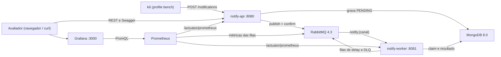
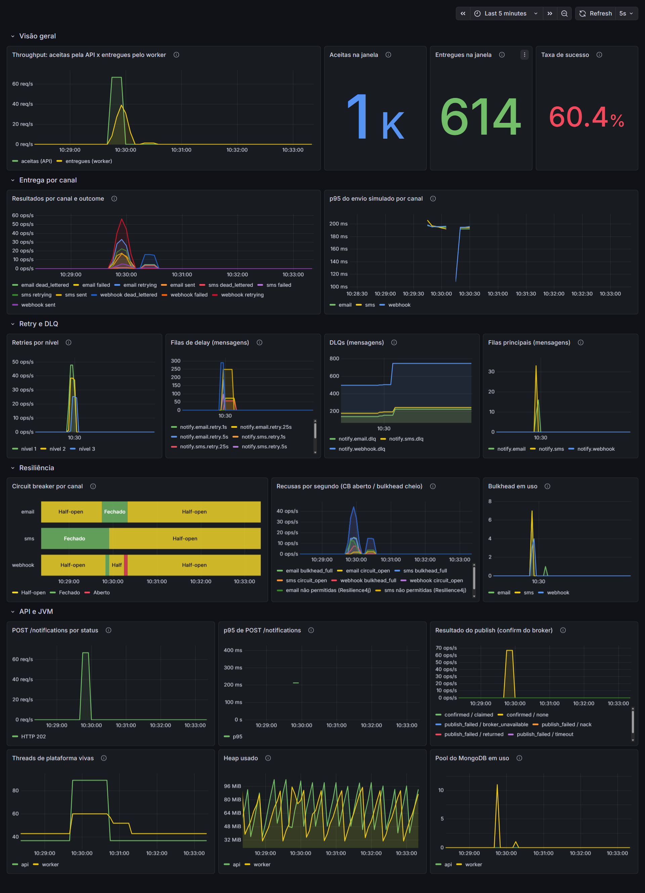

# Notify Hub

Serviço de notificações multicanal (e-mail, SMS e webhook, todos simulados) construído sobre RabbitMQ e MongoDB. A ideia central: **uma notificação aceita pela API nunca se perde em silêncio**. Ela é entregue, passa por uma escada de retries com backoff exponencial ou termina numa DLQ com o histórico completo de tentativas, de onde pode ser reprocessada. Tudo fica visível no Grafana e sobe com um único `docker compose up --build`.

## O que este projeto demonstra

- Retry com backoff exponencial por filas de delay (TTL + dead-letter do RabbitMQ, sem plugin).
- DLQ por canal com reprocessamento seguro por endpoint administrativo.
- Publisher confirms: a API só responde 202 depois do confirm do broker.
- Idempotência por `Idempotency-Key`.
- Circuit breaker e bulkhead por canal (Resilience4j).
- Modelagem NoSQL com índices compostos justificados por `explain()` real.
- Virtual threads do Java 21, medidas num benchmark contra threads de plataforma.
- Métricas no Prometheus e dashboard provisionado no Grafana.
- Testes de integração com RabbitMQ e MongoDB reais (Testcontainers).

A garantia de entrega é **at-least-once**: em casos raros (um crash no meio de um envio) a mesma notificação pode ser enviada duas vezes. Os limites conhecidos estão em [`docs/trade-offs.md`](docs/trade-offs.md).

## Arquitetura



A API grava a notificação, publica o evento e só confirma ao cliente quando o broker confirma. O worker consome uma fila por canal, renderiza o template Mustache guardado no MongoDB e "envia" por um adapter simulado. Componentes, topologia do RabbitMQ e ciclo de vida do status estão em [`docs/arquitetura.md`](docs/arquitetura.md).

## Como rodar

Pré-requisito: só Docker com Compose v2 (Docker Desktop serve). Não precisa de JDK nem de Maven: as imagens são construídas dentro do Docker.

```bash
git clone <url-deste-repositório> notify-hub
cd notify-hub
docker compose up --build
```

Com o stack no ar, em outro terminal, dispare a demo de 1000 notificações:

```bash
docker compose --profile bench run --rm k6
```

- O primeiro build baixa as dependências do Maven e leva alguns minutos. Os seguintes usam cache.
- Os comandos são iguais no PowerShell e no Git Bash.
- O k6 imprime no fim um resumo com quantas notificações terminaram em cada status, por canal.

O roteiro completo (o que olhar no Grafana, destinatários que forçam falhas, reprocessamento da DLQ) está em [`docs/demo.md`](docs/demo.md).

## Onde olhar

| O quê | Endereço | Acesso |
|-------|----------|--------|
| Grafana (dashboard Notify Hub) | http://localhost:3000 | Abre sem login, só leitura. `admin/admin` para editar |
| Painel do RabbitMQ | http://localhost:15672 | `notify/notify` |
| Swagger da API | http://localhost:8080/swagger-ui/index.html | Aberto. Os endpoints `/admin` pedem o header `X-API-Key` |
| Prometheus | http://localhost:9090 | Aberto |

Todas as portas ficam presas a `127.0.0.1` e as credenciais acima valem só para a demo local.



## Destaques

- Escada de retry em filas de delay com TTL por fila: 1s/5s/25s na demo e 5s/25s/125s no perfil padrão.
- O worker reivindica cada notificação com um `findAndModify` cercado por status e contador de retries, o que descarta reentregas duplicadas antes do envio.
- O resultado de cada tentativa (status novo e histórico) é gravado num único update atômico (`$set` + `$push`).
- Recusa do circuit breaker ou do bulkhead é falha transitória: vira retry, nunca FAILED.
- Uma varredura agendada marca como PUBLISH_FAILED o que ficou PENDING sem confirm, e um endpoint administrativo republica.
- Métricas com tags de valores fechados, pré-registradas no startup, para o dashboard nunca mostrar "No data".

## Benchmark: virtual threads x threads de plataforma

Drenagem de um backlog de 30000 notificações pelo worker, mudando só o tipo de thread (200 consumidores por canal, 5 rodadas intercaladas por modo):

| Modo | Mediana (msg/s) | Pico de threads de plataforma | Memória do container (mediana) |
|------|-----------------|-------------------------------|--------------------------------|
| Virtual threads | 744.4 | 40 | 718 MiB |
| Threads de plataforma | 786.2 | 636 | 844 MiB |

Na vazão deu empate: a diferença de cerca de 5% fica bem dentro da dispersão entre rodadas do mesmo modo. A diferença está nas threads de plataforma e na memória. Com virtual threads o pico fica perto de 40 com qualquer concorrência, e com threads de plataforma cresce junto com os consumidores (1536 com 500 por canal). Virtual threads não deixaram este worker mais rápido, mas deixam subir a concorrência sem pagar uma thread do sistema operacional por consumidor.

Medido num i7-4790 (8 threads, 7.7 GiB na VM do Docker Desktop, Windows 11), com outro container sem relação com o projeto dividindo a máquina. Método, todas as rodadas, pinning medido por JFR e como reproduzir em [`docs/benchmark.md`](docs/benchmark.md).

## Documentação

- [`docs/demo.md`](docs/demo.md): roteiro passo a passo da demo, destinatários mágicos, reprocessamento e solução de problemas.
- [`docs/arquitetura.md`](docs/arquitetura.md): componentes, fluxo de uma notificação, topologia do RabbitMQ e ciclo de vida do status.
- [`docs/modelagem-mongo.md`](docs/modelagem-mongo.md): modelo de documentos, índices pela regra ESR e planos reais do `explain()`.
- [`docs/benchmark.md`](docs/benchmark.md): benchmark de virtual threads com método, resultados e limitações.
- [`docs/trade-offs.md`](docs/trade-offs.md): limitações conhecidas, riscos aceitos e o que mudaria em produção.

## Stack

| Item | Versão |
|------|--------|
| Java | 21 |
| Spring Boot | 3.5.16 |
| Spring AMQP / Spring Data MongoDB | gerenciadas pelo Spring Boot |
| Resilience4j | 2.4.0 |
| Micrometer + Prometheus | gerenciado pelo Spring Boot / v3.13.4 |
| RabbitMQ | 4.3.6 |
| MongoDB | 8.0.32 |
| Grafana | 12.4.12 |
| k6 | 2.3.0 |
| Testcontainers | 1.21.4 |

Build Maven multi-módulo: `notify-common` (contrato compartilhado), `notify-api`, `notify-worker` e `notify-it` (testes de integração).

## Testes

```bash
./mvnw test     # testes unitários, sem Docker
./mvnw verify   # inclui os testes de integração com Testcontainers (precisa do Docker)
```

No Windows, sem Git Bash, use `mvnw.cmd` no lugar de `./mvnw`. Aqui, ao contrário da demo, é preciso ter um JDK 21 instalado.

O histórico de planejamento do projeto fica versionado na pasta `.planning/`.
