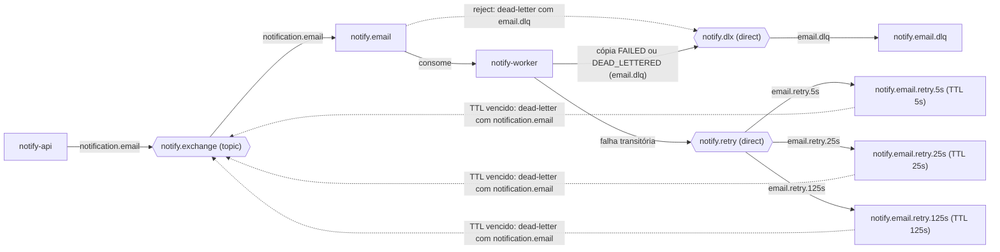
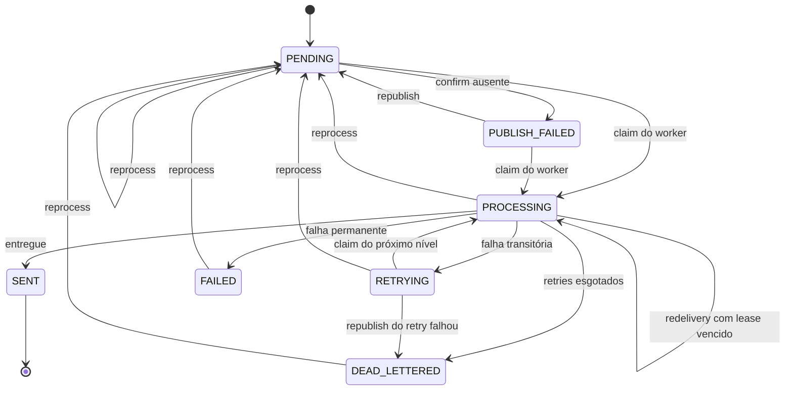

# Arquitetura

Este documento descreve como o Notify Hub é montado: os componentes, o caminho de uma notificação, a topologia do RabbitMQ e os estados por que uma notificação passa. Os nomes de filas, exchanges e status são os do código.

## Componentes

| Componente | Responsabilidade |
|------------|------------------|
| `notify-common` | Contrato compartilhado entre API e worker: os enums `Channel`, `NotificationStatus` (com a tabela de transições permitidas) e `AttemptOutcome`, a mensagem AMQP (`NotificationMessage`, que só carrega o id), a declaração da topologia do RabbitMQ (`NotifyTopology`), o documento do MongoDB e a criação dos índices (`MongoIndexInitializer`). Os dois apps declaram a mesma topologia e os mesmos índices no startup, então qualquer um deles pode subir primeiro. |
| `notify-api` | API REST (Spring MVC em virtual threads). Valida e aceita notificações, publica o evento com publisher confirms, consulta e lista notificações, agrega estatísticas e expõe os endpoints administrativos (reprocessar DLQ, republicar PUBLISH_FAILED). Também roda a varredura agendada de publicações não confirmadas. |
| `notify-worker` | Consome uma fila por canal com listeners em virtual threads. Reivindica a notificação no MongoDB, renderiza o template, chama o adapter simulado do canal atrás de bulkhead e circuit breaker, grava o resultado e decide entre sucesso, retry ou DLQ. Semeia os templates no startup. |
| RabbitMQ 4.3 | Transporte. Três exchanges e, por canal, uma fila principal, uma fila de delay por nível de retry e uma DLQ. |
| MongoDB 8.0 | Fonte da verdade. Coleção `notifications` (estado, histórico de tentativas e conteúdo renderizado) e coleção `templates`. Detalhes em [`modelagem-mongo.md`](modelagem-mongo.md). |
| Prometheus | Coleta a cada 5s o `/actuator/prometheus` da API e do worker e as métricas por fila do plugin `rabbitmq_prometheus`. |
| Grafana | Dashboard **Notify Hub** provisionado por arquivo, aberto sem login como Viewer. |

## Fluxo de uma notificação

1. `POST /notifications` chega na API, que valida o corpo (canal, destinatário no formato do canal, código do template e variáveis). Pedido inválido recebe 400 e nada é gravado.
2. A API grava o documento como PENDING. Com o header `Idempotency-Key`, o índice único parcial garante que dois POSTs com a mesma chave não criem duas notificações.
3. A API publica a mensagem em `notify.exchange` com publisher confirm e `mandatory`. Só responde `202 Accepted` depois do ack do broker. Se o broker recusar (nack), devolver a mensagem por falta de rota ou não confirmar a tempo, o documento vira PUBLISH_FAILED e o cliente recebe `503` com `Retry-After`.
4. O worker recebe a mensagem e reivindica o documento com um `findAndModify` cercado: só passa de PENDING, RETRYING ou PUBLISH_FAILED para PROCESSING se o contador de retries do documento bater com o nível da mensagem. Uma cópia duplicada ou obsoleta não casa com o filtro, é confirmada e descartada sem envio. Uma entrega presa em PROCESSING pode ser retomada quando o lease vence.
5. O worker carrega o template Mustache do MongoDB, confere as variáveis obrigatórias e renderiza a variante do canal. Variável faltando ou template inexistente é falha permanente.
6. A chamada passa por bulkhead, depois circuit breaker, depois o adapter simulado do canal (latência e taxa de falha configuráveis, mais os destinatários mágicos no profile demo).
7. O resultado é gravado num único update atômico: `$set` do status novo e `$push` da tentativa no histórico. Só então o worker faz o ack da mensagem.
8. Se a tentativa falhou:
   - falha transitória com níveis restantes: o documento vira RETRYING e o worker publica uma nova mensagem na fila de delay do próximo nível, com o header `notify-retry-count`. Quando o TTL vence, ela volta para a fila principal e o ciclo recomeça no passo 4;
   - falha permanente: o documento vira FAILED, sem gastar retries, e uma cópia vai para a DLQ do canal com o header `x-failure-class: PERMANENT`. Uma exceção que o classificador não reconhece (provável bug) também vira FAILED, com a classe `UNKNOWN`, em vez de ficar tentando;
   - retries esgotados: o documento vira DEAD_LETTERED e uma cópia vai para a DLQ com `x-failure-class: TRANSIENT`.

A mensagem original só é confirmada depois que a cópia para a fila de delay ou para a DLQ foi confirmada pelo broker. Se essa cópia falhar, a original é rejeitada sem requeue e cai na DLQ pela dead-letter da fila principal. Em nenhum caminho a mensagem é devolvida para a fila com requeue, o que evitaria um laço quente com uma mensagem que sempre falha.

Do lado da API, uma varredura agendada procura documentos PENDING sem claim e com mais de 2 minutos (o caso de uma queda entre a gravação e o publish) e os marca como PUBLISH_FAILED. `POST /admin/notifications/republish-failed` republica esses documentos.

## Topologia do RabbitMQ

Três exchanges duráveis:

| Exchange | Tipo | Papel |
|----------|------|-------|
| `notify.exchange` | topic | Principal. Roteia `notification.<canal>` para `notify.<canal>` |
| `notify.retry` | direct | Recebe os retries. Roteia `<canal>.retry.<ttl>` para a fila de delay do nível |
| `notify.dlx` | direct | Dead-letter. Roteia `<canal>.dlq` para `notify.<canal>.dlq` |

O diagrama mostra o canal de e-mail com a escada padrão. SMS e webhook têm exatamente a mesma estrutura, trocando `email` por `sms` ou `webhook`.

São 15 filas no total: 3 principais, 9 de delay e 3 DLQs. Os níveis da escada são configuráveis (`notify.topology.retry-levels`) e o nome de cada fila de delay vem do TTL:

| Ambiente | Níveis | Filas de delay (e-mail) |
|----------|--------|-------------------------|
| Padrão (produção) | 5s, 25s, 125s (fator 5) | `notify.email.retry.5s`, `.retry.25s`, `.retry.125s` |
| Profile `demo` | 1s, 5s, 25s | `notify.email.retry.1s`, `.retry.5s`, `.retry.25s` |
| Testes de integração | milissegundos | por exemplo `notify.email.retry.200ms` |

Por que este desenho:

- **TTL por fila, não por mensagem.** O RabbitMQ só expira mensagens que estão na cabeça da fila. Numa fila de delay única com `expiration` por mensagem, uma mensagem de 125s na frente seguraria uma de 5s atrás dela (head-of-line blocking). Com uma fila por nível, todas as mensagens de uma fila têm o mesmo TTL e saem na ordem em que entraram.
- **Sem o plugin de delayed message.** TTL e dead-letter são recursos nativos do broker. O plugin `rabbitmq_delayed_message_exchange` guarda as mensagens agendadas fora das filas, não é replicado, tem limites de escala conhecidos e esconderia a escada do painel de gerenciamento. Com filas de delay, cada nível aparece no painel com a sua profundidade.
- **Retry por mensagem nova, não por retry em memória.** O worker não segura a thread esperando o backoff e não perde o estado se cair: a tentativa seguinte está numa fila durável. O nível vem do header `notify-retry-count`, gravado pela aplicação, e não do `x-death` do broker.
- **Filas clássicas duráveis.** Num nó só, filas de quorum trariam limite de entregas e semântica de dead-lettering próprias sem ganho real. O RabbitMQ 4.3 recusa filas transientes não exclusivas e os argumentos de filas clássicas v1, então a topologia não usa nenhum dos dois.
- **Mudar argumento de fila exige `docker compose down -v`.** O broker não aceita redeclarar uma fila existente com argumentos diferentes (TTL, dead-letter) e responde `406 PRECONDITION_FAILED`. Como os volumes guardam as filas entre execuções, trocar a escada pede apagar o volume do RabbitMQ.

## Ciclo de vida do status

Os 7 status e as transições abaixo são exatamente os da tabela de `NotificationStatus`. Toda mudança de status no MongoDB é um update condicional que confere o status de origem.

Como ler as transições menos óbvias:

- **PUBLISH_FAILED → PROCESSING.** Um confirm que não chegou a tempo não prova que a mensagem não chegou ao broker. Se ela chegou, o worker pode reivindicar o documento normalmente.
- **PROCESSING → PROCESSING.** Se o worker cair no meio de uma entrega, a mensagem volta (redelivery) e outro consumidor retoma o documento quando o lease vence.
- **RETRYING → DEAD_LETTERED.** Se o broker não confirmar a mensagem para a fila de delay, o worker não arrisca perder o retry: o documento vai direto para DEAD_LETTERED, com uma cópia na DLQ.
- **PENDING, PROCESSING e RETRYING → PENDING.** São usadas só pelo reprocessamento, para o caso raro de uma mensagem ir para a DLQ com o documento ainda num status intermediário (por exemplo, o MongoDB fora do ar no momento do claim). PROCESSING só é reaberto com o lease vencido.

SENT é o único estado sem saída. FAILED e DEAD_LETTERED também são terminais para o fluxo automático: nada os tira dali sozinho. A notificação fica parada, com a mensagem na DLQ, até alguém chamar `POST /admin/dlq/{canal}/reprocess`. O reprocessamento tira a mensagem da DLQ, volta o documento para PENDING com o contador de retries zerado, registra um evento `REPROCESSED` no histórico e republica com confirm. As tentativas anteriores continuam no array `attempts` e o total de tentativas (`attemptCount`) não é zerado, então o histórico completo fica preservado.

## Resiliência

Cada canal tem o seu bulkhead e o seu circuit breaker (Resilience4j, configurados por canal no `application.yml` do worker). A ordem de chamada é **bulkhead → circuit breaker → adapter**:

- O bulkhead é de semáforo, não de pool de threads, para o trabalho continuar na virtual thread do listener. Ele limita as chamadas simultâneas ao provedor do canal.
- O circuit breaker registra só falhas transitórias. Uma falha permanente (destinatário recusado, payload inválido) diz respeito à notificação, não à saúde do provedor, e não abre o circuito.
- O tempo que o circuito fica aberto é validado no startup para nunca passar do primeiro nível da escada: quando a primeira retentativa chega, o circuito já está meio aberto e aceita testes. No profile demo ele fica aberto por 500ms.
- Recusa do bulkhead (cheio) ou do circuit breaker (aberto) é tratada como falha transitória (`BULKHEAD_FULL`, `CIRCUIT_OPEN`): vira retry e consome um nível da escada, nunca FAILED. A consequência é que, durante uma abertura longa, notificações válidas podem esgotar a escada e terminar DEAD_LETTERED. O reprocessamento as recupera depois. Isso está registrado em [`trade-offs.md`](trade-offs.md).

## Observabilidade

As métricas de negócio têm tags com conjunto fechado de valores (canal, outcome, classe de falha, nível) e são pré-registradas no startup com zero, para os painéis nunca mostrarem "No data" antes do primeiro evento.

| Métrica | Tags | O que mede | Onde aparece no dashboard |
|---------|------|------------|---------------------------|
| `notify_delivery_outcomes_total` | `channel`, `outcome`, `failure_class` | Desfecho de cada tentativa no worker (`sent`, `retrying`, `failed`, `dead_lettered`), com a classe da falha (`transient`, `permanent`, `unknown`) | Visão geral (entregues e taxa de sucesso) e Entrega por canal |
| `notify_delivery_retries_total` | `channel`, `level` | Retries publicados por nível da escada | Retry e DLQ: "Retries por nível" |
| `notify_delivery_rejections_total` | `channel`, `reason` | Recusas antes do adapter (`circuit_open`, `bulkhead_full`) | Resiliência: "Recusas por segundo" |
| `notify_delivery_duration_seconds` | `channel`, `outcome` (`success`, `transient_failure`, `permanent_failure`) | Duração da chamada ao adapter, com histograma | Entrega por canal: p95 do envio simulado |
| `notify_publish_outcomes_total` | `outcome`, `reason` | Resultado do publish na API (`confirmed` ou `publish_failed` por nack, devolução, timeout, broker fora ou varredura) | API e JVM: "Resultado do publish" |
| `resilience4j_circuitbreaker_state` | `name`, `state` | Estado do circuit breaker de cada canal | Resiliência: "Circuit breaker por canal" |
| `rabbitmq_detailed_queue_messages` | `queue` | Mensagens em cada fila, vindas do broker | Retry e DLQ: filas de delay, DLQs e filas principais |

Além dessas, o dashboard usa as métricas padrão do Spring Boot: `http_server_requests_seconds` (POST por status e p95), threads e heap da JVM e o pool de conexões do driver do MongoDB.

## Virtual threads

`spring.threads.virtual.enabled=true` está ligado nos dois apps. Na API, cada requisição do Tomcat roda numa virtual thread. No worker, os listeners do RabbitMQ (`SimpleMessageListenerContainer`) usam um executor de virtual threads, um consumidor por unidade de concorrência do canal, e as tarefas agendadas também. Todo o código continua bloqueante (driver síncrono do MongoDB, `RabbitTemplate`, `sleep` no adapter simulado), que é justamente o modelo em que virtual threads fazem diferença.

O benchmark que compara virtual threads e threads de plataforma no worker, com método e números, está em [`benchmark.md`](benchmark.md). As limitações do desenho como um todo estão em [`trade-offs.md`](trade-offs.md).
