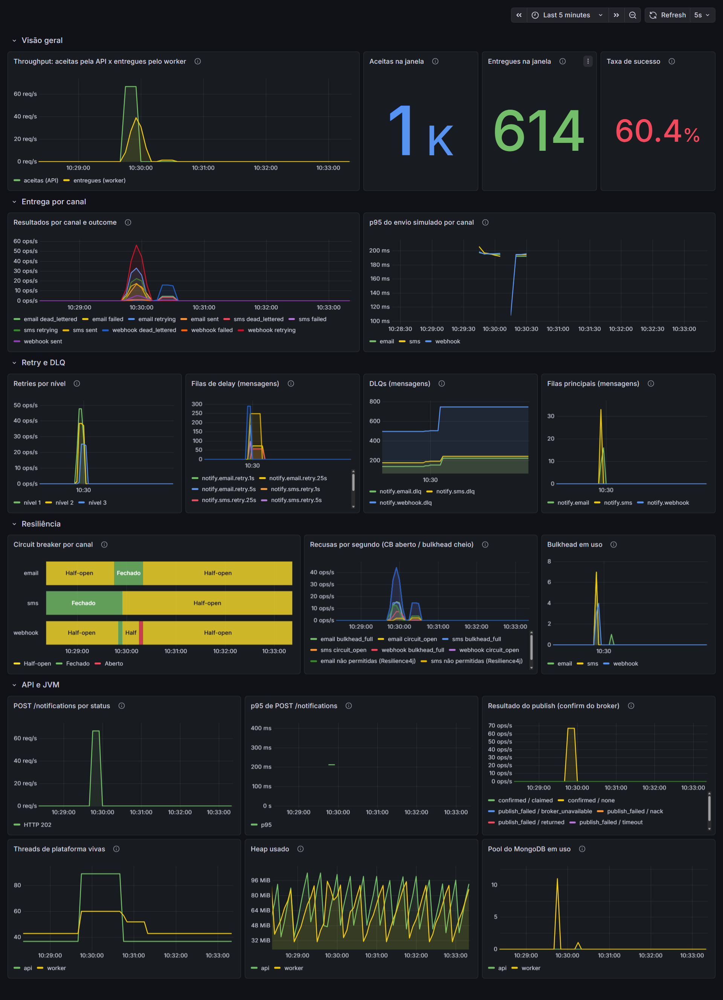
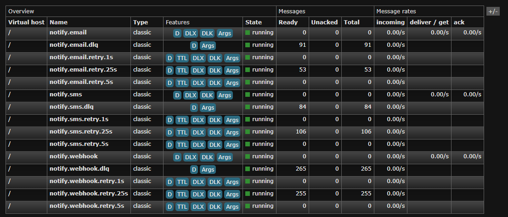

# Roteiro da demo

Este roteiro leva uns 10 minutos e mostra o caminho completo de uma notificação: aceita pela API, entregue, reenviada pela escada de retry, parada na DLQ e reprocessada. Tudo roda localmente com o profile `demo`, que usa a escada curta de 1s/5s/25s e liga os destinatários mágicos (endereços reservados que forçam falhas previsíveis).

Os exemplos usam `curl`, que já vem no Git Bash e no Windows 10/11. No PowerShell, chame `curl.exe` para não cair no alias `Invoke-WebRequest`.

## 1. Subir o stack

Na raiz do repositório:

```bash
docker compose up --build
```

O primeiro build baixa as dependências do Maven dentro do Docker e leva alguns minutos. Quando o log parar de andar, confira em outro terminal:

```bash
docker compose ps
```

`rabbitmq`, `mongo`, `api` e `worker` devem aparecer como `healthy`. `prometheus` e `grafana` não têm healthcheck e aparecem só como `running`.

## 2. Abrir o Grafana e o painel do RabbitMQ

- Grafana: http://localhost:3000. Abre sem login, direto no dashboard **Notify Hub**, só para leitura. Para editar, entre com `admin/admin`.
- RabbitMQ: http://localhost:15672, usuário `notify` e senha `notify`. Vá na aba **Queues and Streams**.

Deixe os dois abertos lado a lado antes de disparar a carga.

## 3. Disparar o k6

```bash
docker compose --profile bench run --rm k6
```

O k6 manda 1000 `POST /notifications` com 50 usuários virtuais, num mix fixo de canais, templates e destinatários mágicos. O webhook recebe a maior parte dos destinatários com falha transitória, de propósito, para abrir o circuit breaker dele. Depois do último POST, o script espera a escada de retry terminar (cerca de 35 segundos) e imprime um resumo como este:

```
==== RESUMO NOTIFY HUB (k6) ====
novas=1000 aguardou=36s
não terminais: PENDING=0 PROCESSING=0 RETRYING=0
terminais da rodada: SENT=640 FAILED=41 DEAD_LETTERED=319 PUBLISH_FAILED=0
EMAIL: SENT=270 FAILED=15 DEAD_LETTERED=49 PUBLISH_FAILED=0
SMS: SENT=265 FAILED=16 DEAD_LETTERED=52 PUBLISH_FAILED=0
WEBHOOK: SENT=105 FAILED=10 DEAD_LETTERED=218 PUBLISH_FAILED=0
```

- `novas` é quantas notificações a rodada criou. As contagens são diferenças contra uma linha de base lida no início, então rodadas anteriores não entram.
- `não terminais` precisa terminar em zero: nada ficou preso no meio do caminho.
- `FAILED` são falhas permanentes (foram direto para a DLQ). `DEAD_LETTERED` esgotou os três retries.
- Os números exatos variam um pouco entre rodadas, porque dependem de quando o circuit breaker abre e fecha.

O k6 sai com erro se mais de 1% dos POSTs falhar ou se a rodada não drenar em 3 minutos.

## 4. O que observar no Grafana

O dashboard tem quatro rows. Durante o k6, de cima para baixo:

- **Visão geral.** O gráfico de throughput mostra as aceitas pela API e as entregues pelo worker. As entregues vêm atrasadas e em degraus, porque parte das mensagens volta da escada de retry 1s, 5s e 25s depois. Os stats da janela e a taxa de sucesso fecham a conta.
- **Entrega por canal.** Resultados por canal e por outcome (sent, failed, dead_lettered, retrying) e o p95 do envio simulado.
- **Retry e DLQ.**
  - "Retries por nível" mostra três ondas: nível 1 (1s), nível 2 (5s) e nível 3 (25s).
  - "Filas de delay" enche e esvazia em ondas. Cada mensagem fica lá o TTL do nível e volta para a fila principal.
  - "DLQs" cresce e para de crescer quando a rodada termina. Ela só desce com um reprocessamento.
  - "Filas principais" deve ficar perto de zero: o worker acompanha a carga.
- **Resiliência.**
  - "Circuit breaker por canal" mostra o estado do CB do webhook. No profile demo o CB fica aberto só 500ms antes de passar para meio aberto, e o Prometheus coleta a cada 5s, então o estado OPEN quase nunca cai numa amostra. O que aparece é o vaivém entre CLOSED e HALF_OPEN.
  - Por isso o painel "Recusas por segundo" fica ao lado: cada recusa `circuit_open` é uma tentativa barrada com o CB aberto. É ali que a abertura aparece com clareza.
  - "Bulkhead em uso" mostra as chamadas simultâneas por canal.
- **API e JVM.** POST por status HTTP, p95 do POST e o painel "Resultado do publish", em que todo POST aceito aparece como `confirmed` (o 202 só sai depois do confirm do broker). Threads, heap e o pool do MongoDB completam a row.



## 5. O que observar no RabbitMQ

Na aba **Queues and Streams** existem 15 filas, cinco por canal:

| Fila | Papel |
|------|-------|
| `notify.email`, `notify.sms`, `notify.webhook` | Fila principal do canal, consumida pelo worker |
| `notify.<canal>.retry.1s`, `.retry.5s`, `.retry.25s` | Filas de delay da escada. Ninguém consome: a mensagem expira pelo TTL e volta para a fila principal |
| `notify.<canal>.dlq` | Dead-letter queue do canal |

Durante o k6, as colunas de mensagens das filas `retry` sobem e descem em ondas, e as `.dlq` crescem. Clique numa DLQ e use **Get messages** (com "Ack mode: Nack message requeue true", para não consumir) para ver os headers `x-failure-class` e `notify-retry-count`.



## 6. Destinatários mágicos

No profile `demo`, alguns destinatários reservados escolhem um roteiro de falha determinístico. Qualquer outro destinatário segue o fluxo normal. Nada sai da máquina: os adapters são simulados, o domínio `.test` é reservado e os números `+55 00…` não existem.

| Roteiro | E-mail | Webhook | SMS |
|---------|--------|---------|-----|
| `always-transient`: falha transitória sempre | `always-transient@fail.test` | `https://fail.test/always-transient` | `+550000000001` |
| `always-permanent`: falha permanente na primeira tentativa | `always-permanent@fail.test` | `https://fail.test/always-permanent` | `+550000000002` |
| `fail-<N>-then-ok`: falha N vezes e depois entrega | `fail-2-then-ok@fail.test` | `https://fail.test/fail-2-then-ok` | `+5500000001N3` (N de 1 a 9; `+550000000123` falha 2 vezes) |
| `fail-until-reprocess`: falha até ser reprocessada | `fail-until-reprocess@fail.test` | `https://fail.test/fail-until-reprocess` | `+550000000004` |

Com três níveis de retry, um `fail-N-then-ok` com N até 3 termina SENT e com N de 4 em diante termina DEAD_LETTERED.

Para ver uma notificação passar pela escada inteira:

```bash
curl -i -X POST http://localhost:8080/notifications \
  -H "Content-Type: application/json" \
  -d '{"channel":"EMAIL","recipient":"always-transient@fail.test","templateCode":"welcome","variables":{"name":"Ana"}}'
```

A resposta é `202 Accepted`, com o `id` no corpo e no header `Location`. Uns 35 segundos depois:

```bash
curl http://localhost:8080/notifications/<id>
```

O status é `DEAD_LETTERED`, e `attempts` traz as quatro tentativas (o envio inicial e os três retries), cada uma com horário, resultado e código do erro.

## 7. Reprocessar a DLQ

```bash
curl -X POST -H "X-API-Key: demo-admin-key" "http://localhost:8080/admin/dlq/webhook/reprocess?max=500"
```

`demo-admin-key` é a chave fixa do profile demo, só para uso local. Fora da demo a chave vem de variável de ambiente e, se estiver vazia, todos os endpoints `/admin` recusam o acesso.

A resposta tem quatro contagens:

| Campo | Significado |
|-------|-------------|
| `requested` | O `max` efetivo da chamada (padrão 100, no máximo 1000) |
| `reprocessed` | Mensagens tiradas da DLQ, com a notificação zerada para PENDING e republicada com confirm do broker |
| `skipped` | Mensagens devolvidas para o fim da DLQ sem reprocessar, por exemplo porque a notificação ainda está sendo processada |
| `discarded` | Mensagens retiradas sem republicar, porque a notificação já está SENT ou não existe |

O reprocessamento zera o contador de retries e preserva o histórico: as tentativas antigas continuam em `attempts`, com um evento `REPROCESSED` marcando a volta.

Por que destinatários normais do webhook também estão na DLQ? Quando o circuit breaker abre, as tentativas recusadas contam como falha transitória e consomem um nível da escada. Uma notificação válida que pegou o CB aberto nas quatro tentativas termina DEAD_LETTERED. Isso é esperado, e o reprocessamento existe para esse caso: com o CB já fechado, essas notificações viram SENT. O mesmo vale para os `fail-until-reprocess`, que só entregam depois de reprocessados. Já um `fail-N-then-ok` reprocessado volta a falhar N vezes, porque o contador de retries recomeça do zero. Os `always-transient` e `always-permanent` voltam para a DLQ.

Depois do reprocessamento, rode a mesma chamada para `email` e `sms` se quiser esvaziar as outras DLQs.

## 8. Outros endpoints

Republicar o que ficou em PUBLISH_FAILED (notificações gravadas cujo publish o broker não confirmou):

```bash
curl -X POST -H "X-API-Key: demo-admin-key" "http://localhost:8080/admin/notifications/republish-failed"
```

Numa demo saudável a resposta costuma ser `{"requested":100,"republished":0}`: o broker confirmou tudo.

Listar com filtros e paginação:

```bash
curl "http://localhost:8080/notifications?status=DEAD_LETTERED&channel=WEBHOOK&page=0&size=20"
```

Contagens agregadas por status e por canal (é daqui que o k6 tira o resumo):

```bash
curl http://localhost:8080/notifications/stats
```

Todos os endpoints, com exemplos de requisição e resposta, estão no Swagger: http://localhost:8080/swagger-ui/index.html.

## Solução de problemas

- **`406 PRECONDITION_FAILED` ao subir, ou a API/worker não ficam healthy depois de mudar argumentos de fila.** O RabbitMQ não aceita redeclarar uma fila com argumentos diferentes (TTL, dead-letter). Se você mudar a escada de retry ou a topologia, apague os volumes: `docker compose down -v` e suba de novo.
- **Porta ocupada.** O stack publica 8080, 8081, 3000, 9090, 5672, 15672, 15692 e 27017 em `127.0.0.1`. Pare apps locais que usem essas portas. O benchmark (`scripts/bench/run-bench.sh`) usa as mesmas portas e para a demo antes de rodar. Depois dele, volte com `docker compose up -d`.
- **O primeiro build é lento.** É o download das dependências do Maven dentro do Docker. Os builds seguintes reaproveitam o cache.
- **Git Bash convertendo caminhos.** O Git Bash troca argumentos que começam com `/` por caminhos do Windows (`/scripts/demo.js` vira `C:/Program Files/Git/scripts/demo.js`). Por isso o caminho do script do k6 já fica no `command` do `docker-compose.yml`. Se você rodar à mão um comando com caminho de dentro do container, prefixe com `MSYS_NO_PATHCONV=1`, por exemplo `MSYS_NO_PATHCONV=1 docker compose exec -T mongo mongosh notify --quiet --eval "db.notifications.countDocuments()"`.
- **Contagens que só crescem.** O MongoDB e o RabbitMQ guardam os dados em volumes, então os totais do `/stats`, as DLQs e o dashboard acumulam entre rodadas. O resumo do k6 já desconta a linha de base. Para começar do zero: `docker compose down -v`.
- **Resumo do k6 estranho.** Não misture tráfego manual (os `curl` acima, reprocessamentos) enquanto o k6 roda: o resumo mede a diferença global do `/stats` e contaria esse tráfego como se fosse da rodada.
